# Phone screens

Rendered from the real Compose code with fixed example data (`PhoneScreensTest`).

## Watch: nearby

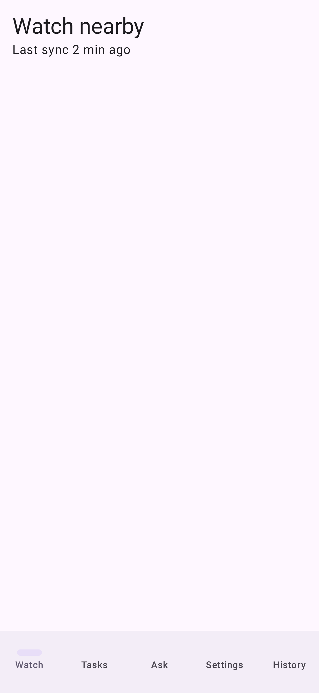

## Watch: relayed

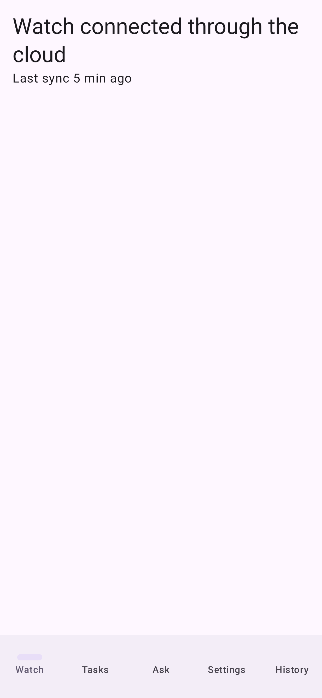

## Watch: away

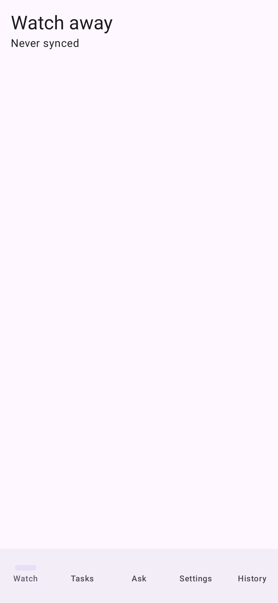

## Watch: no watch app

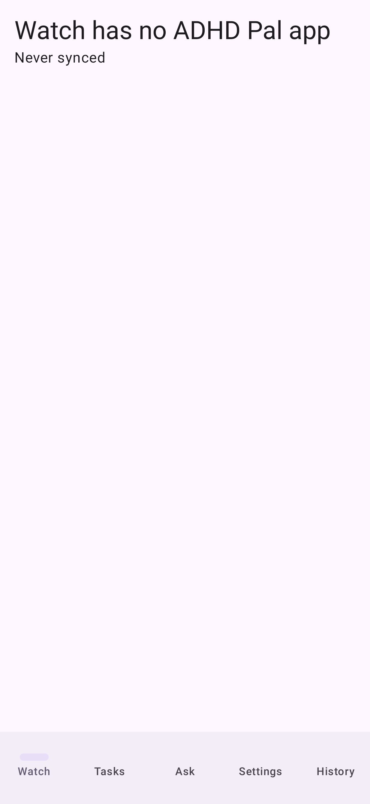

## Watch: incompatible

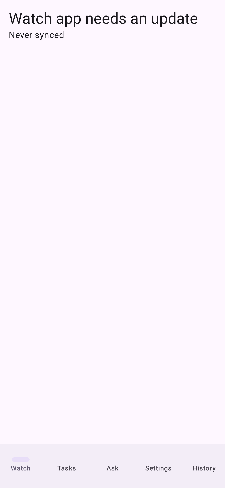

## Alert permissions missing

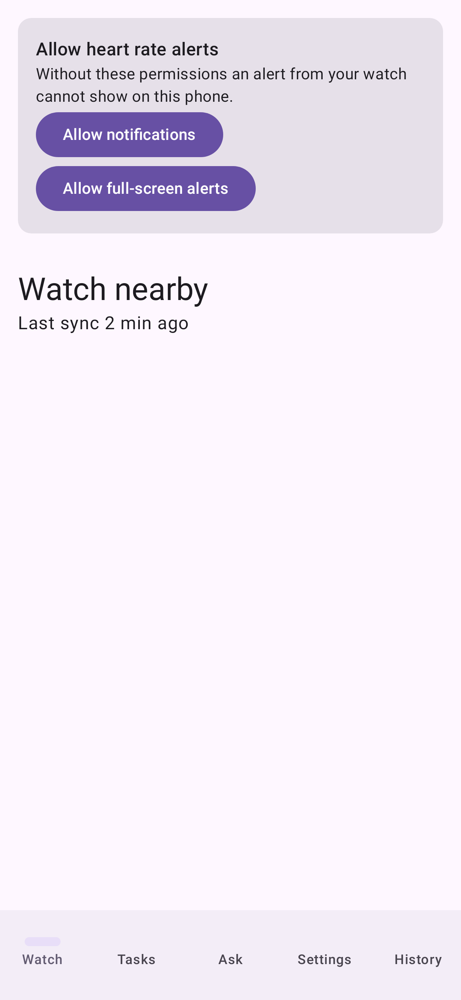

## History: acknowledgement, answer, alert

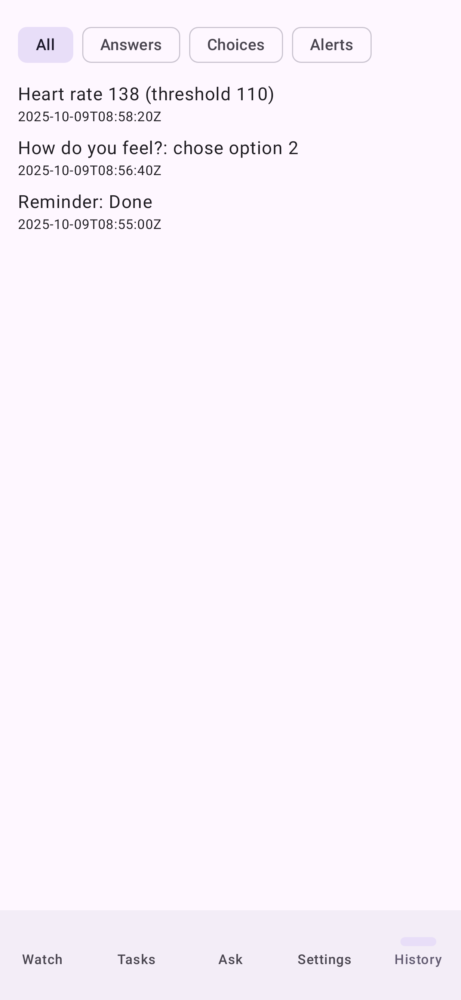

## History: empty

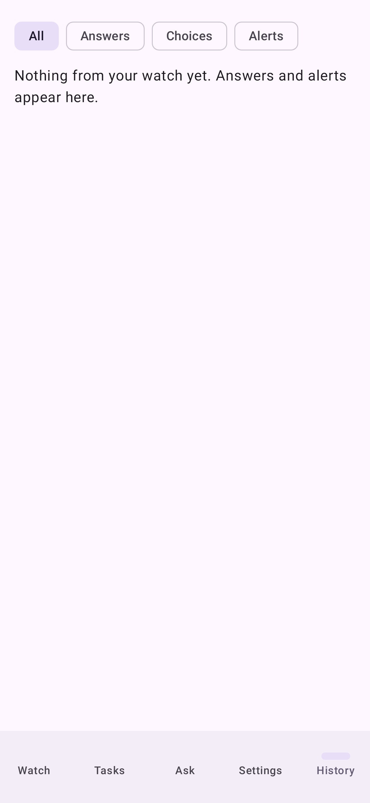

## History: failed

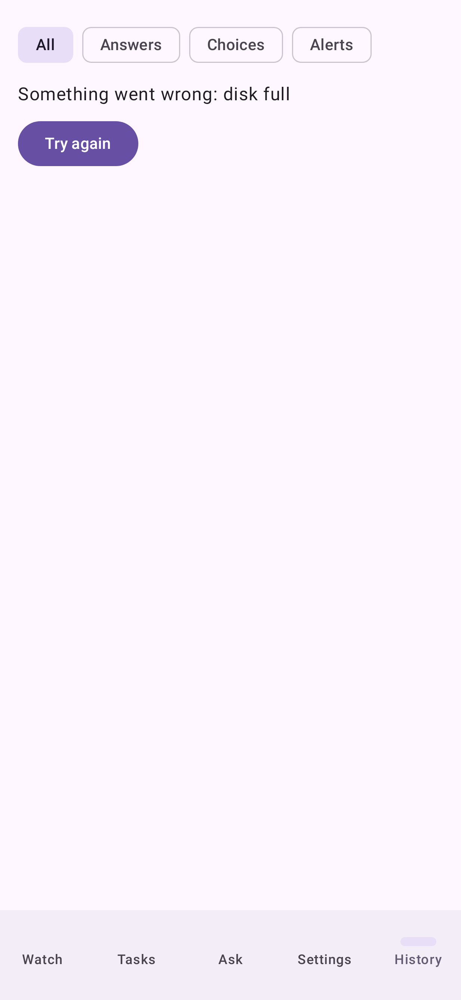

## Settings

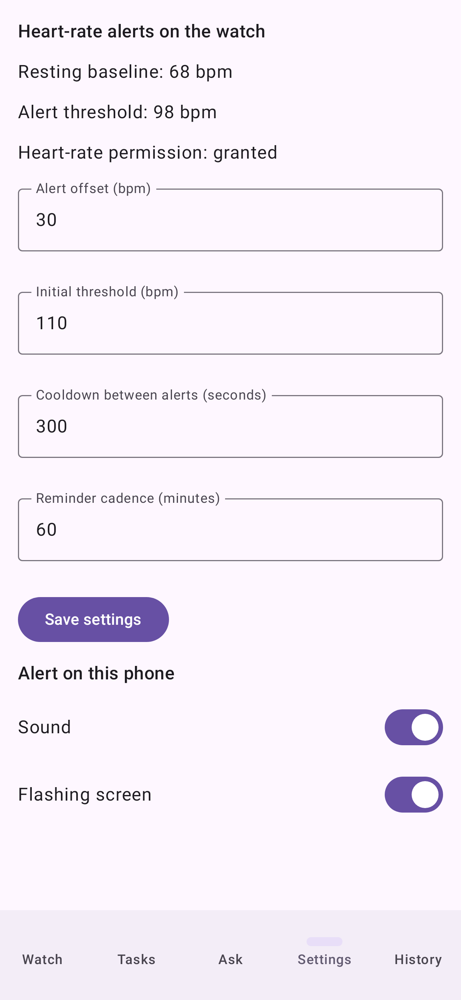

## Ask the watch a question

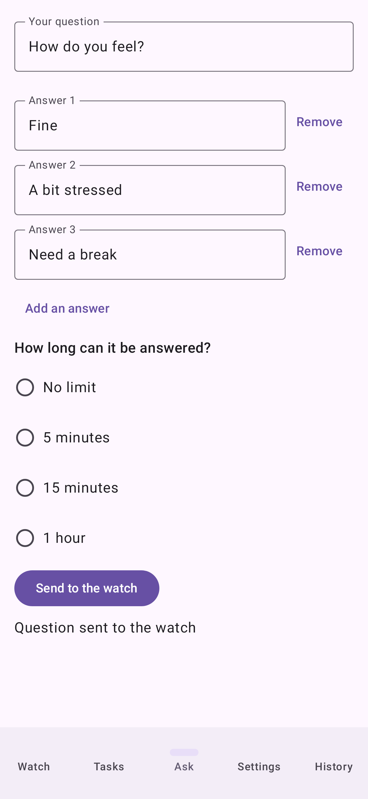

## Tasks

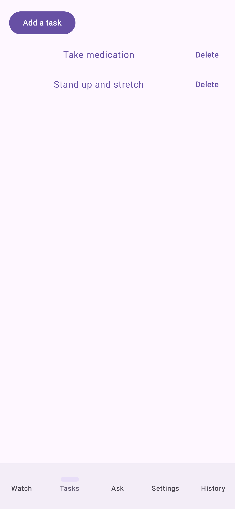

## Tasks: empty

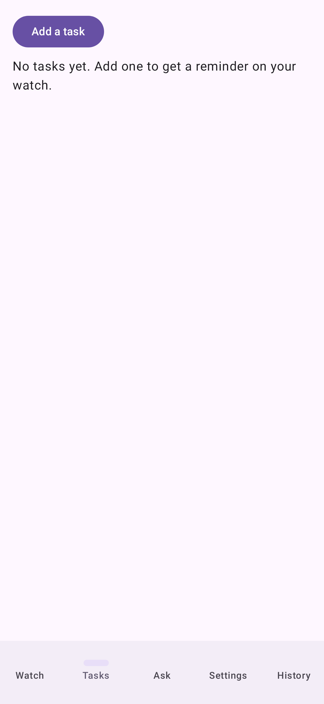

## Alert from the watch

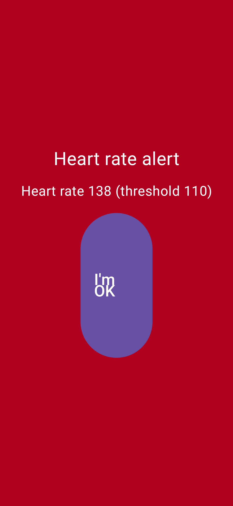
