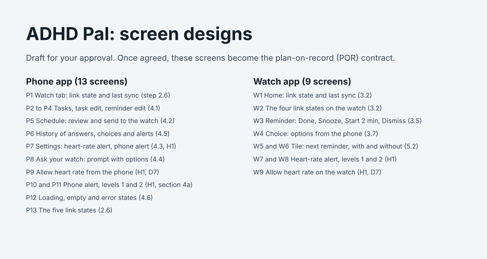

# ADHD Pal: UI/UX design (proposed design)

Status: **proposed design**, for the user's approval. Until the user approves it (recorded in
[issue #154](https://github.com/shlomoa/my-adhd-pal/issues/154)) it is a proposal, not the plan-on-record. Once agreed,
these screens become the contract for the screen steps of [`../plan.md`](../plan.md): 2.6, 3.2-3.7, 4.1-4.6, 5.2 and H1.

The designs come from the design canvas
[ADHD Pal screen designs](https://claude.ai/artifact/MREz2fe1cVjhLqmoRtACPV): 13 phone screens (P1-P13) and 9 watch
screens (W1-W9). The images are in [`images/`](images) and their sources in [`source/`](source/README.md).

## Table of contents

| Document | Contents |
|---|---|
| [Solution](solution.md) | how the pieces fit: data flow and event flow, each with a description |
| [Phone main flow](phone-main-flow.md) | P1 Watch tab, P2 Tasks, P3 Task edit, P4 Reminder edit, P5 Schedule, P6 History |
| [Phone settings, prompts and alerts](phone-settings-prompts-alerts.md) | P7 Settings, P8 Ask your watch, P9 Allow heart rate, P10-P11 Phone alert levels 1 and 2, P12 Loading, empty and error, P13 Five link states |
| [Watch main flow](watch-main-flow.md) | W1 Home, W2 Link states, W3 Reminder, W4 Choice |
| [Watch tile and alerts](watch-tile-alerts.md) | W5-W6 Tile (with and without a reminder), W7-W8 Heart-rate alert levels 1 and 2, W9 Allow heart rate |

## Screens and the plan steps they document

| Screen | Plan step |
|---|---|
| P1 Watch tab: link state and last sync | 2.6 |
| P2-P4 Tasks, task edit, reminder edit | 4.1 |
| P5 Schedule: review and send to the watch | 4.2 |
| P6 History of answers, choices and alerts | 4.5 |
| P7 Settings: heart-rate alert, phone alert | 4.3, H1 |
| P8 Ask your watch: prompt with options | 4.4 |
| P9 Allow heart rate from the phone | H1 (D7) |
| P10-P11 Phone alert, levels 1 and 2 | H1 ([`biometrics.md`](../plans/biometrics.md) section 4a) |
| P12 Loading, empty and error states | 4.6 |
| P13 The five link states | 2.6 |
| W1 Home: link state and last sync | 3.2 |
| W2 The four link states on the watch | 3.2 |
| W3 Reminder: Done, Snooze, Start 2 min, Dismiss | 3.5 |
| W4 Choice: options from the phone | 3.7 |
| W5-W6 Tile: next reminder, with and without | 5.2 |
| W7-W8 Heart-rate alert, levels 1 and 2 | H1 |
| W9 Allow heart rate on the watch | H1 (D7) |

## Open design points

- The tile's primary action is **undecided**: Done on W5 is a placeholder ([Watch tile and alerts](watch-tile-alerts.md)).
- Settings opens from the gear on the Watch tab (P1).
- Where the canvas and the contracts differ, the contract wins until the design is approved; each section lists the
  differences it found.
