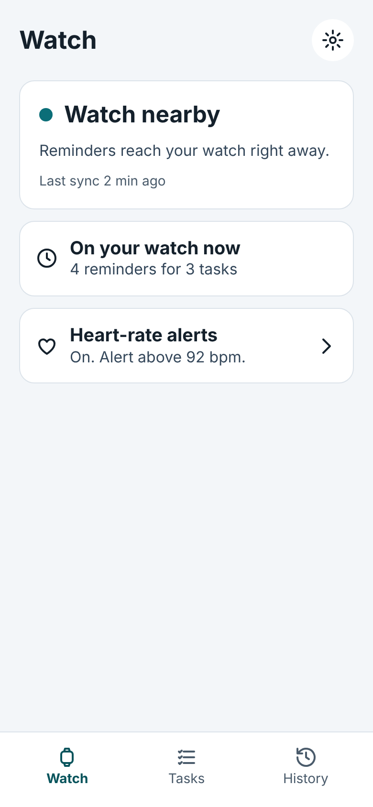
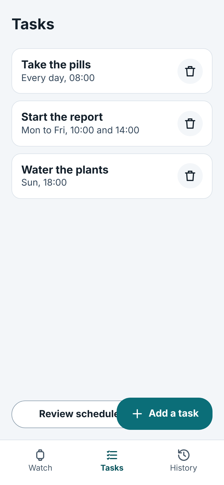
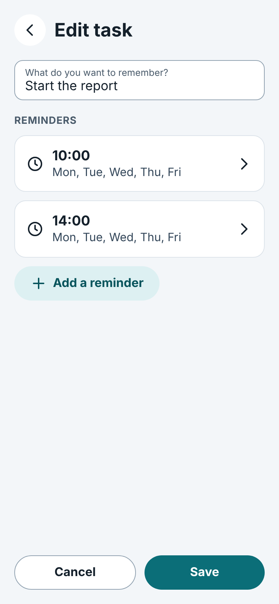
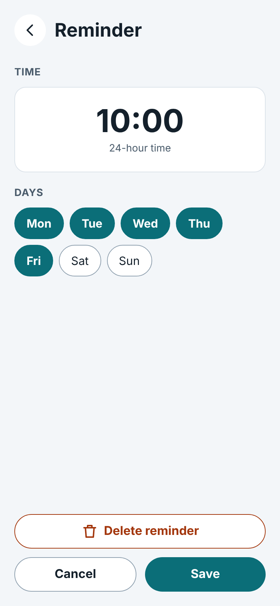
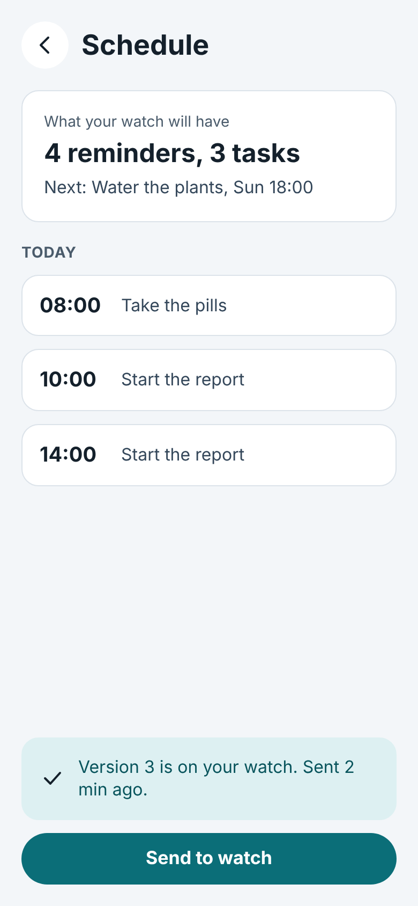
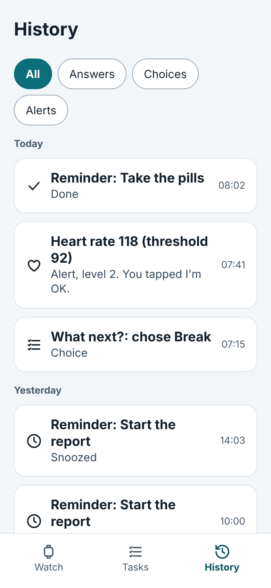

# Phone main flow (proposed design)

Part of the [UI/UX design](README.md), a **proposed design** until the user approves it. Screens P1-P6 are the three tabs
(Watch, Tasks, History) and the screens reached from them. The bottom navigation has the three tabs; Settings opens from
the gear on the Watch tab.

## P1 Watch tab (link state)

The first screen. A large card shows the link state with a dot and a sentence ("Watch nearby. Reminders reach your watch
right away.") and the time of the last sync. Below it: how many reminders for how many tasks are on the watch now, and a
card for the heart-rate alerts ("On. Alert above 92 bpm.") that leads to the settings. The gear in the top bar opens
Settings (P7). The card has no controls: the link state is information only (step 2.6). All five states are on P13.

## P2 Tasks tab

The list of tasks, each with its title and a plain-language summary of its reminders ("Mon to Fri, 10:00 and 14:00") and a
delete button. "Add a task" is a floating button; "Review schedule for the watch" opens P5. An empty list is shown by P12.

## P3 Task edit

A task is a title and its reminders. The title field is labelled "What do you want to remember?". Each reminder shows its
time and days and opens P4; "Add a reminder" adds one. Cancel and Save are at the bottom.

## P4 Reminder edit

A reminder is a time of day (24-hour) and the days it repeats on, shown as seven toggle chips. A reminder can be deleted
here. These are the fields of the protocol's `Reminder` (`minuteOfDay`, `days`).

## P5 Schedule (send to watch)

A review of what the watch will have: the number of reminders and tasks, the next reminder and the day's list. "Send to
watch" publishes a new schedule version; after a send the screen says which version is on the watch and when it was sent
("Version 3 is on your watch. Sent 2 min ago."). Nothing is sent if the content is unchanged
([data layer](../data-layer.md), publishing).

## P6 History tab

What came back from the watch, newest first and grouped by day: answers to reminders (Done, Snoozed, Started 2 minutes),
choices from prompts and heart-rate alerts with the value and threshold and what the user did. Chips filter All,
Answers, Choices and Alerts. An empty history is shown by P12. This is the `HistoryRepository`.
