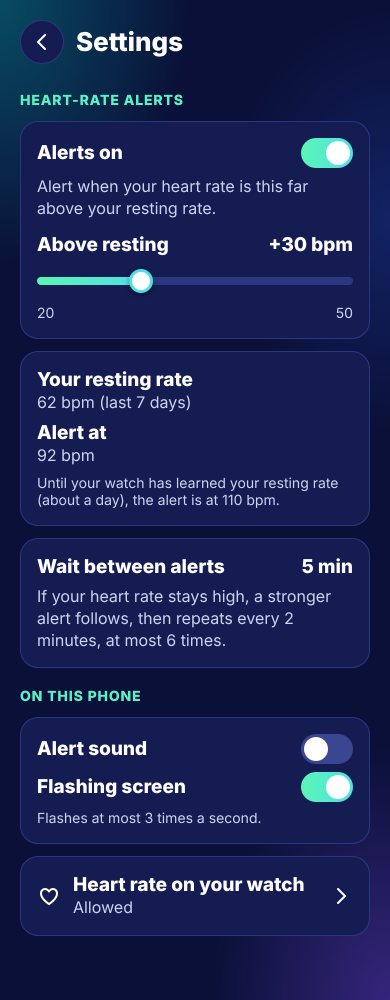
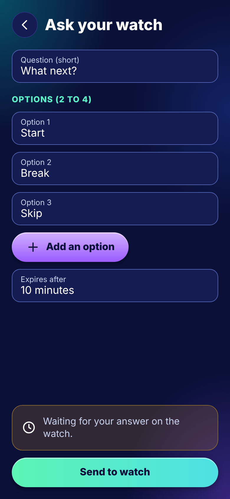
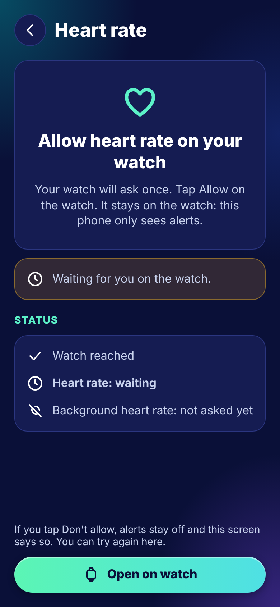
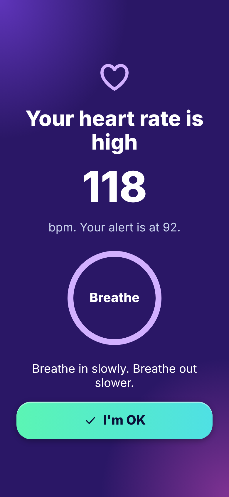
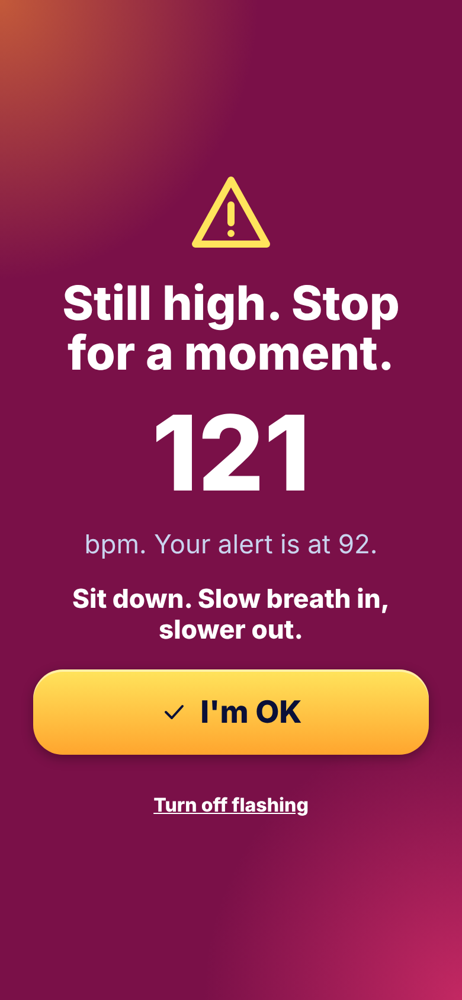
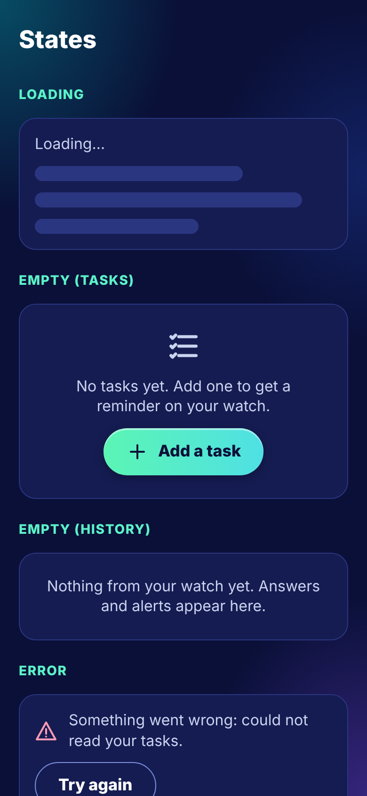
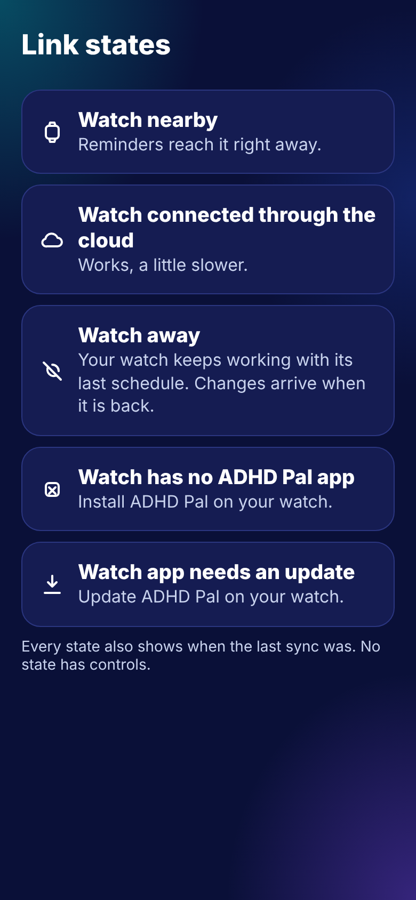

# Phone settings, prompts and alerts (proposed design)

Part of the [UI/UX design](README.md), a **proposed design** until the user approves it. Screens P7-P13: settings, the
prompt that asks the watch a question, heart-rate permission, the two phone alert levels, the common states and the five
link states.

## P7 Settings

Opens from the gear on the Watch tab (P1). Heart-rate alerts: an on/off switch and the offset above the resting rate
(slider from 20 to 50, shown +30), the resting rate the watch learned ("62 bpm (last 7 days)"), the resulting alert level
("92 bpm") and a note that until the watch has learned the resting rate (about a day) the alert is at 110 bpm. "Wait
between alerts" shows 5 minutes and says that a stronger alert follows if the rate stays high, then repeats every 2
minutes, at most 6 times. On this phone: alert sound (off by default) and flashing screen (at most 3 flashes a second).
A row shows whether heart rate is allowed on the watch and leads to P9. The values are the decisions D3 and D4 of
[`biometrics.md`](../plans/biometrics.md).

## P8 Ask your watch (prompt)

The phone asks a short question and the watch answers with a tap: a question field, options, an expiry ("Expires after 10
minutes") and "Send to watch". After sending, the screen says it is waiting for the answer on the watch. The answer shows
up in History (P6) as a choice. The canvas says "Options (2 to 4)"; the data-layer contract accepts 2 to 6
([data layer](../data-layer.md), prompts), so the limit shown to the user is an open design point.

## P9 Allow heart rate (onboarding)

The permission is a runtime permission of the watch app, so the phone cannot grant it; "Open on watch" starts the permission
screen on the watch (W9) and the user taps Allow there ([`biometrics.md`](../plans/biometrics.md) section 5, D7). The screen
lists the status (watch reached, heart rate: waiting, background heart rate: not asked yet) and says what happens if the user
taps Don't allow: alerts stay off, this screen says so, and the user can try again here. Heart rate data stays on the watch;
the phone only sees alerts.

## P10 Phone alert, level 1

When an `/alert` arrives the phone raises its own alert ([`biometrics.md`](../plans/biometrics.md) section 4a). Level 1 is a
full-screen alert in the aurora style (violet midnight with aurora light): a heart icon, "Your heart rate is high", the value and the alert level, a breathing circle and one big
"I'm OK" button that ends the episode.

## P11 Phone alert, level 2

Level 2 is the stronger, escalated alert: a magenta and amber aurora instead of violet, an alert triangle instead of the heart, larger type and button ("Still high. Stop for a moment."), the
value and the instruction to sit down and breathe slowly. "I'm OK" ends the episode. "Turn off flashing" is always
available. Level 2 repeats every 2 minutes, at most 6 times.

## P12 Loading, empty and error

One board shows the common states of the lists (step 4.6): loading (skeleton lines and "Loading…"), empty Tasks ("No
tasks yet. Add one to get a reminder on your watch." with an Add button), empty History ("Nothing from your watch yet.") and
an error with a plain sentence and "Try again".

## P13 The five link states

The five states of `LinkState` with their icon and sentence: Nearby, Relayed ("Watch connected through the cloud. Works, a
little slower."), Away ("Your watch keeps working with its last schedule. Changes arrive when it is back."), No watch app
and Incompatible ("Watch app needs an update"). Every state also shows when the last sync was; no state has controls. The
meaning and the precedence of the states are in [`../protocol.md`](../protocol.md), "Link states".
