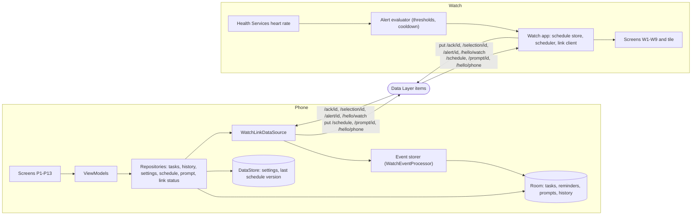
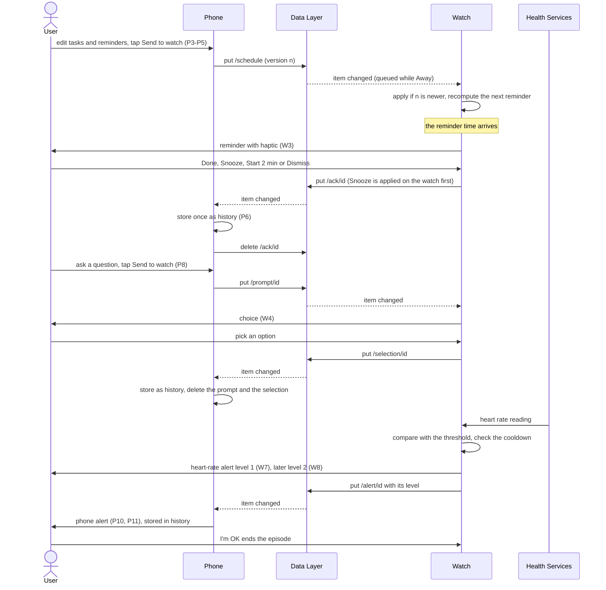

# Solution (proposed design)

Part of the [UI/UX design](README.md), a **proposed design** until the user approves it. This page shows how the screens
are fed: the data flow (what is stored where and which way items travel) and the event flow (what happens, in order, when
the user or the heart rate does something). Both are derived from [`../protocol.md`](../protocol.md),
[`../data-layer.md`](../data-layer.md) and [`../plans/biometrics.md`](../plans/biometrics.md); they add no behaviour.

## Data flow

The phone is the master. The user's tasks, reminders, prompts and history live in Room and the settings and the last
published schedule version in DataStore; the screens read them only through ViewModels and repositories, and the Data
Layer is reached only through `WatchLinkDataSource` (the rules of [`../data-layer.md`](../data-layer.md)). The schedule
builder turns tasks, reminders and settings into a versioned `/schedule` item (P5) and prompts become `/prompt/<id>`
items (P8). The watch keeps the last schedule it received and applies only a newer version, so it keeps working while it is
away. It never edits the phone's master data: what it sends back (`/ack`, `/selection`, `/alert`) becomes history rows only
(P6). Each node deletes only the items it wrote, except that the phone deletes a watch-written event after storing it.
The link state shown on P1, P13, W1 and W2 is not stored: it is derived from the connected nodes, the app capability and
the peer's hello item.

## Event flow

The flow reads from top to bottom and shows the three kinds of event. A **schedule** goes phone to watch when the user
sends it (P5); the watch fires reminders from its stored schedule by itself, so the phone need not be nearby, and each
action on the reminder (W3) goes back as an acknowledgement that the phone stores as history. A **prompt** goes phone to
watch (P8) and the answer comes back as a selection (W4). A **heart-rate alert** starts on the watch: the readings come from
Health Services, the thresholds and the cooldown are evaluated on the watch, level 1 shows first, level 2 follows if the
rate is still above the threshold after the cooldown and repeats every 2 minutes at most 6 times, and each alert also
reaches the phone, which raises its own alert and stores it ([`../plans/biometrics.md`](../plans/biometrics.md) sections 3
and 4a). While the link is Away, items wait in the Data Layer and arrive when it is back; the event diagrams in
[`../protocol.md`](../protocol.md), "Diagrams", give the detail of each exchange.
