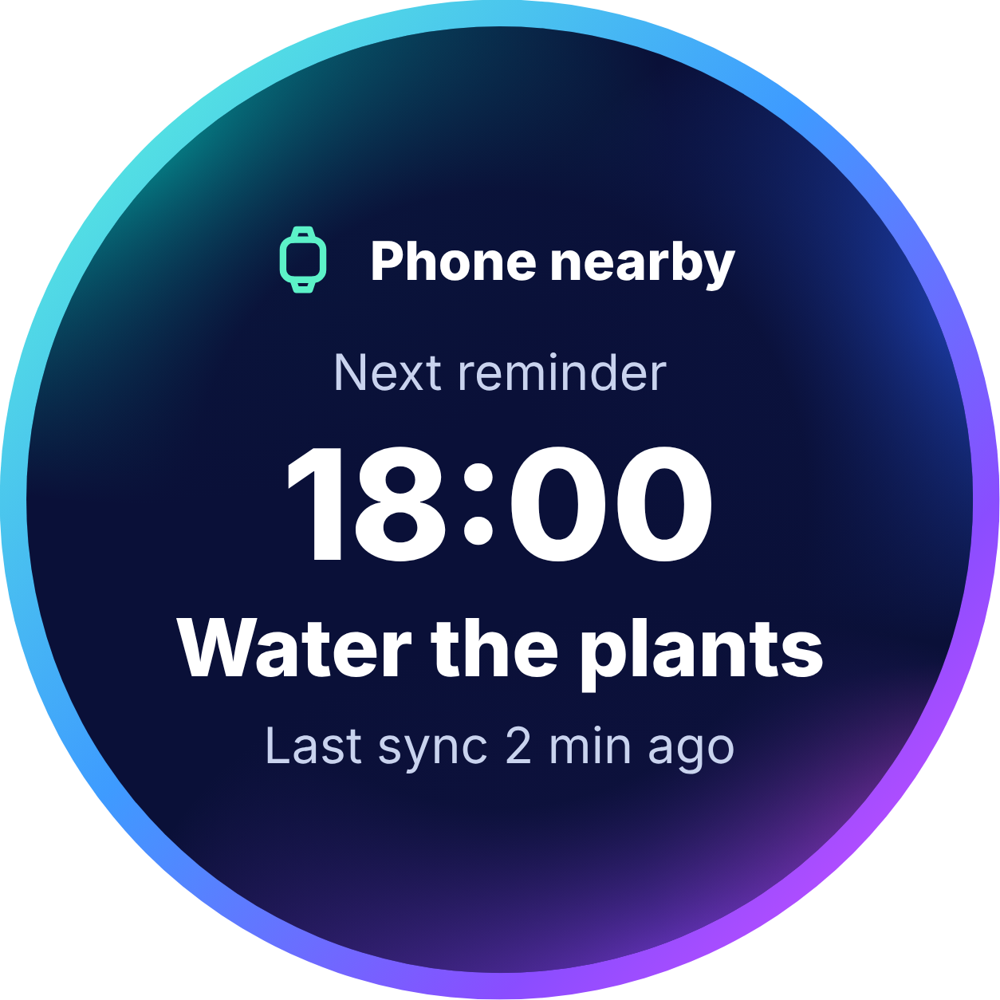
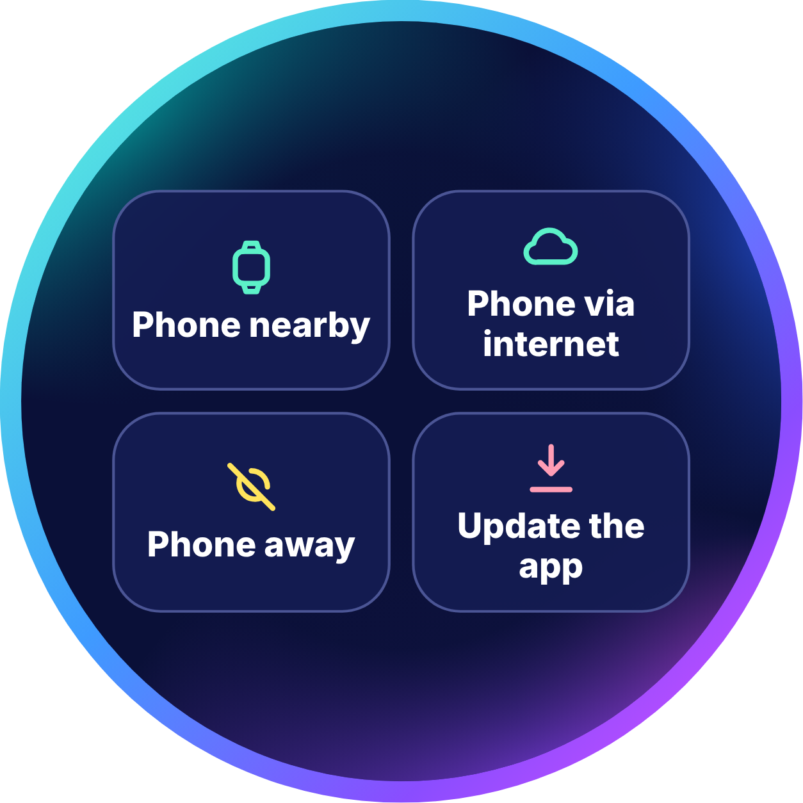
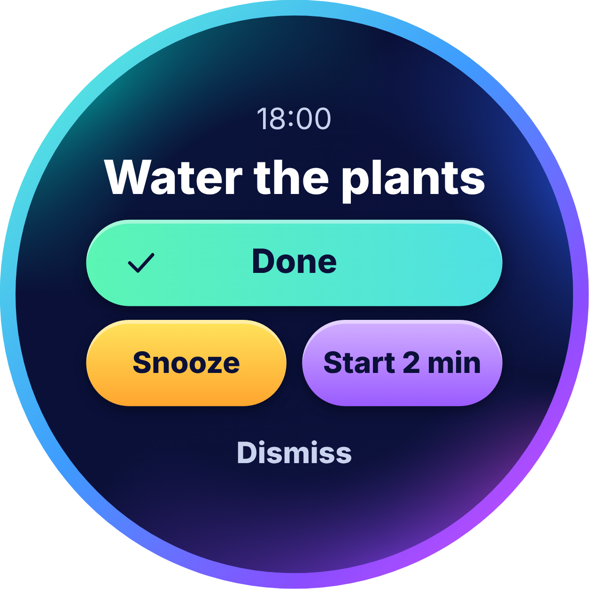
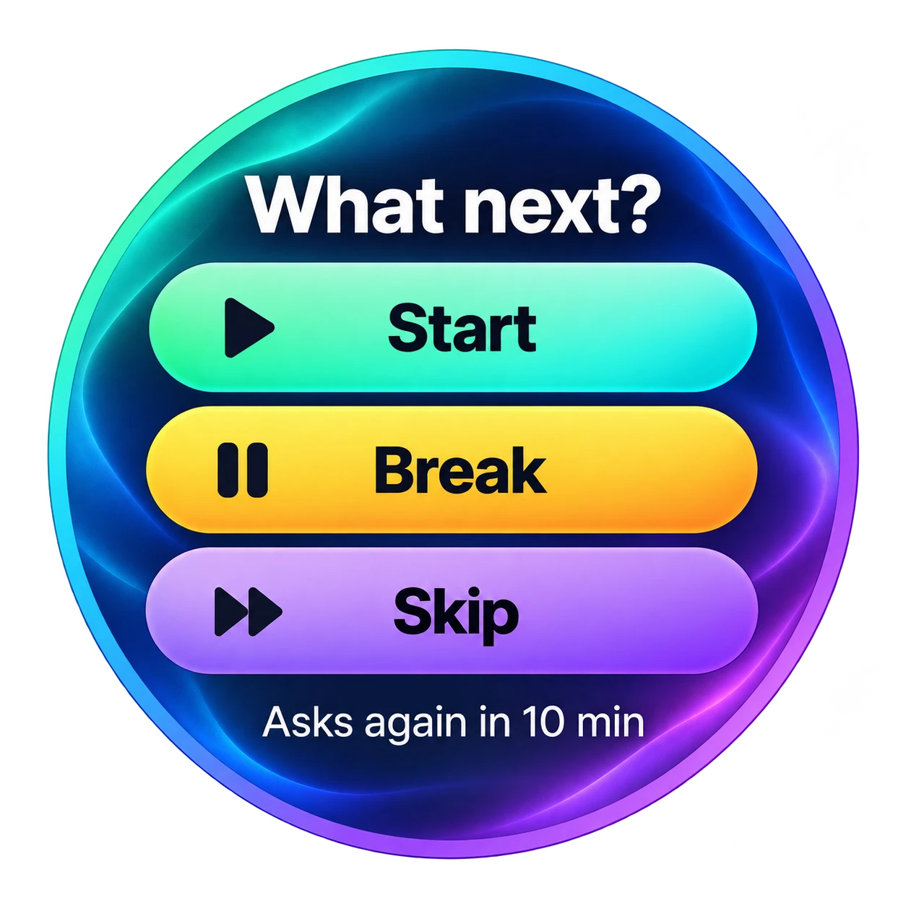

# Watch main flow (proposed design)

Part of the [UI/UX design](README.md), a **proposed design** until the user approves it. Screens W1-W4 are the watch app
itself: the home screen, its link states, a reminder and a choice. The watch face is round with a gradient ring and the aurora on midnight blue ([style](README.md#style-aurora)); the images are the round face only, transparent outside the circle.

## W1 Home

The link state ("Phone nearby"), the next reminder (time and title, "18:00 Water the plants") and the last sync. It has no
controls (step 3.2).

## W2 Link states

The watch shows four states as tiles inside the round face: Phone nearby, Phone via internet, Phone away and Update the app. The phone's fifth state, No
watch app, does not exist on the watch: the watch calls the same function and shows No phone app as Away
([`../protocol.md`](../protocol.md), "Link states").

## W3 Reminder

When a reminder fires: the time and the title with the four actions of the protocol's `Acknowledgement`: Done (the
highlighted button), Snooze, Start 2 min and Dismiss. Snooze is applied on the watch at once, within the cap and the
expiry rules, and the choice is reported to the phone as an acknowledgement (`/ack`).

## W4 Choice

An option prompt from the phone (P8). This image is the approved aurora reference supplied by the user, and the other screens follow its style: the question and the options as large pills with an icon on the left, Start (mint to turquoise, play icon), Break (yellow to amber, pause icon) and Skip (lavender to violet, forward icon), and a line saying when it asks again
("Asks again in 10 min"). The tap is reported as a selection (`/selection`). A prompt past its expiry is hidden.
