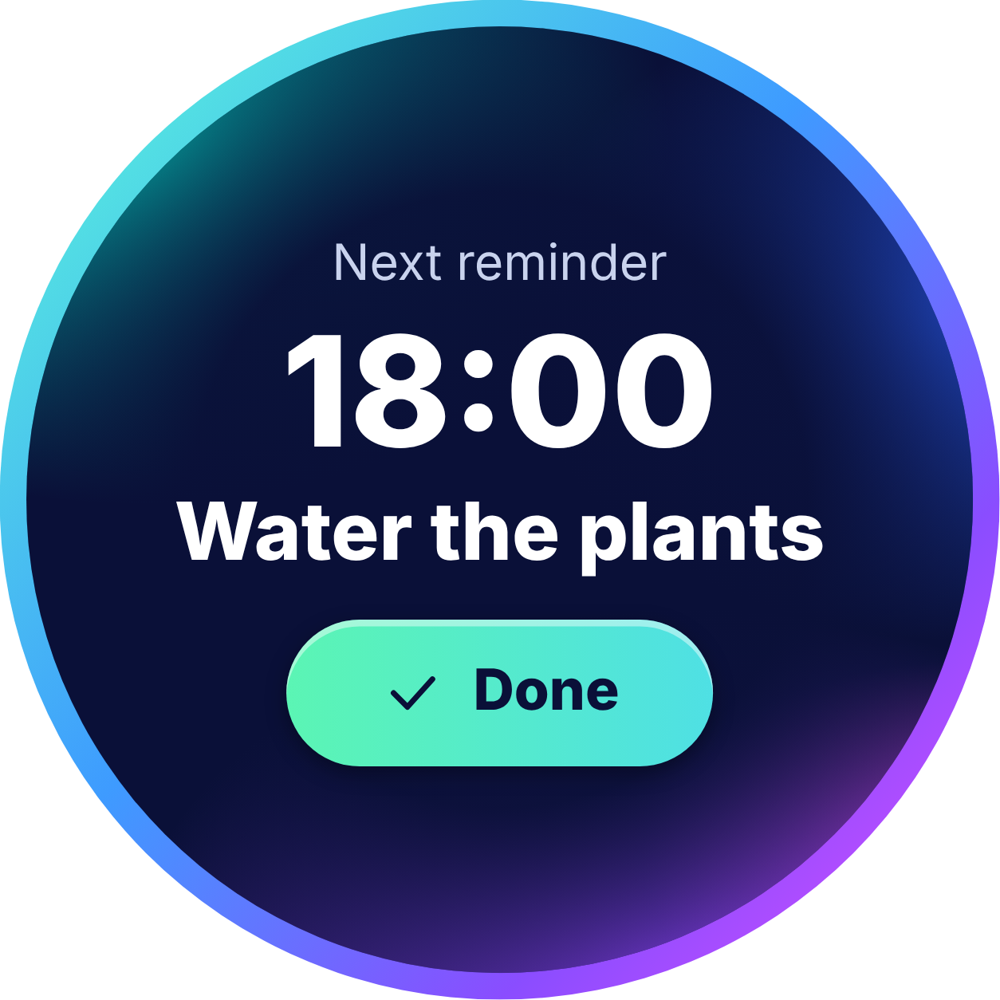
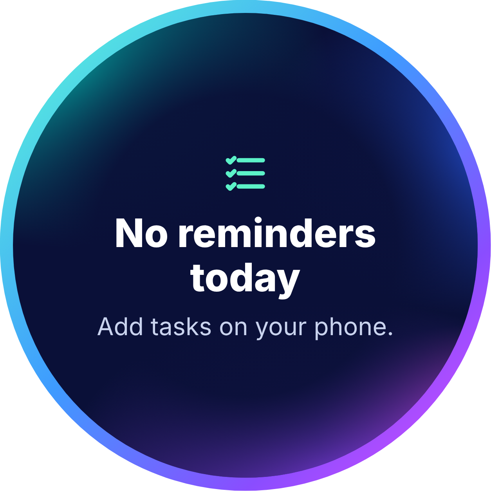
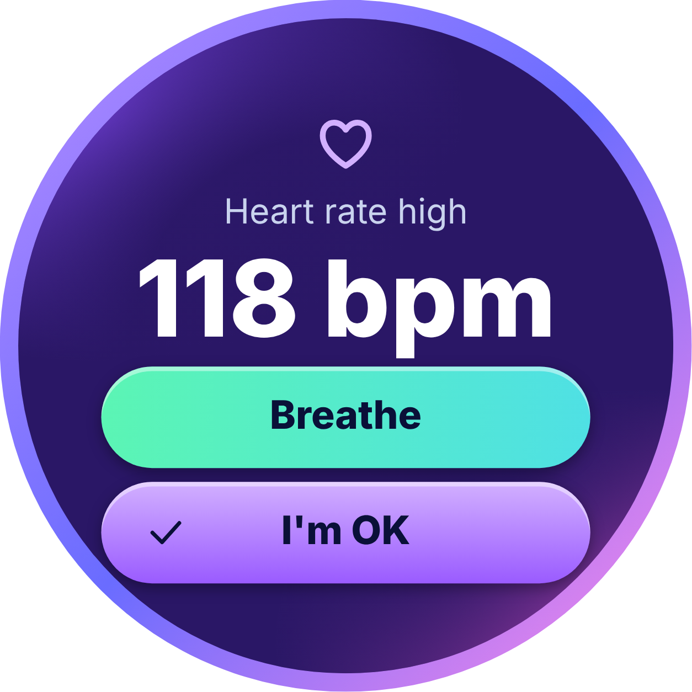
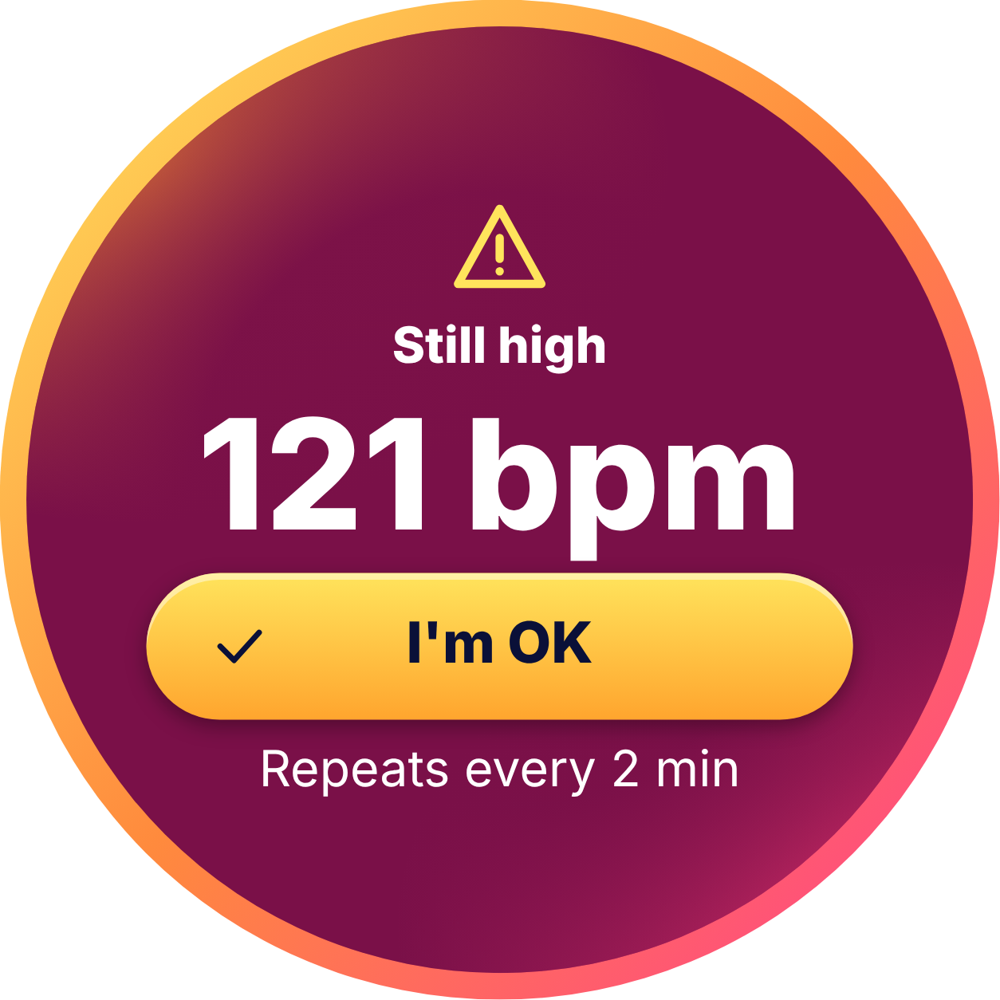
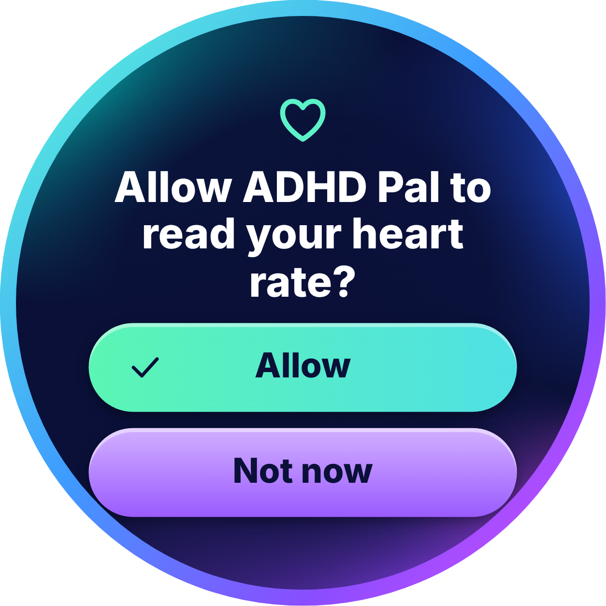

# Watch tile and alerts (proposed design)

Part of the [UI/UX design](README.md), a **proposed design** until the user approves it. Screens W5-W9: the tile, the two
heart-rate alert levels on the watch and the permission request.

## W5-W6 Tile

The tile shows the next reminder (time, title) and one button (step 5.2). **The tile's primary action is undecided: Done is
a placeholder**, to be decided with the user. Without any reminder the tile says "No reminders today. Add tasks on your
phone."

## W7 Heart-rate alert, level 1

The first alert when the heart rate is above the threshold: "Heart rate high", the value, "Breathe" and "I'm OK". The watch
vibrates and wakes the screen ([`biometrics.md`](../plans/biometrics.md) section 4). The phone raises its own alert (P10).

## W8 Heart-rate alert, level 2

The escalation: "Still high", the value, "I'm OK" and "Repeats every 2 min", with an alert triangle instead of the heart and an amber to magenta ring and aurora instead of violet. It follows level 1 when
the rate is still above the threshold after the 5-minute cooldown, then repeats every 2 minutes, at most 6 times.
"I'm OK" ends the episode.

## W9 Allow heart rate

The watch's own request: "Allow ADHD Pal to read your heart rate?" with Allow and Not now. It is reached from the phone
(P9, "Open on watch"). The permission stays on the watch ([`biometrics.md`](../plans/biometrics.md) section 5).
