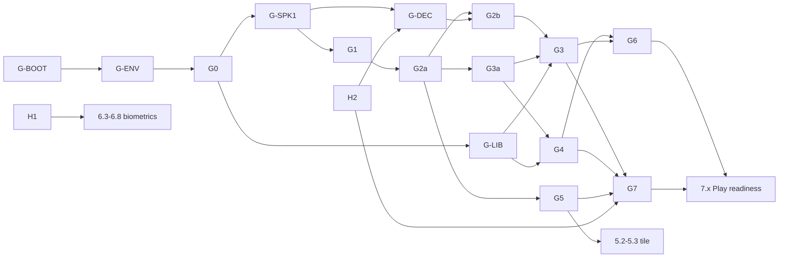

# Execution plans: overview, gates and schedule

Status: **approved**, aligned to the merged [`../plan.md`](../plan.md) (milestones 0a to 7). That file stays the
authority for architecture, decisions and step definitions; these files only say **who does which step, in what
order, and how parallel work is kept safe**. Step ids such as `0a.8` or `3.4` are `plan.md` step ids.

Lane plans: [shared and data](shared.md), [Android](android.md), [watch](watch.md), [Documentation](docs.md), [Validation](validation.md).

## Lanes

| Lane | Owns | plan.md steps |
|---|---|---|
| **S** Shared and data | tooling, restructure, spikes, `docs/protocol.md`, `:protocol`, phone data layer | 0a.1-0a.8, 0b.1-0b.3, 1.1-1.8, 2.1-2.5 |
| **A** Android | phone UI, DI wiring, phone features, Play readiness | 2.6, 2.7, 4.1-4.6, 7.1-7.6 |
| **W** Watch | everything in `:wear`, tile, biometrics (including the pure-logic evaluator 6.5 in `:protocol`) | 3.1-3.9, 5.1-5.3, 6.1-6.8 |
| **D** Documentation | UI/UX design documentation in `docs/design/` (proposed design, issue #154) | none (documents steps 2.6, 3.2-3.7, 4.1-4.6, 5.2, H1) |
| **V** Validation | post-merge run of the script tests on `main`, the `main-red` issue, watching each merge (issue #190) | none (checks all lanes' steps) |

The lanes run in parallel. Work that a lane cannot start is blocked by a gate (below) and the lane stops.

## Working assumptions (confirm on review)

1. The lane split above ("shared and data" is not defined in `plan.md`).
2. Steps that need a person (emulator pairing in Android Studio, real watch and phone, the 24-hour reminder run,
   agreeing biometric thresholds) are gates the user closes; the lanes never wait by polling.
3. Gate PRs are merged by the user. Each `plan.md` step is one GitHub issue (starting with its Validation plan) and one
   PR that closes it, as `plan.md` section 5 requires.

## Validation first and last (every lane)

| | First step (V-first) | Last step (V-last) |
|---|---|---|
| Do | Write the **test-case catalogue** `docs/test-plans/<lane>.md` (ids `TC-<S\|A\|W>-nnn`: what, how (unit, CI, manual), pass criteria), generate the test code, run it. | Run the **entire** suite and every CI check on merged `main`; run the lane's manual checklist. |
| Evidence | `docs/test-reports/<lane>-baseline.md`: each id **red**, with command, output excerpt, commit SHA. The red commit precedes any implementation commit. | `docs/test-reports/<lane>-final.md`: each id **PASS**, counts, zero skipped. |
| Checked by | `scripts/check-test-cases.sh <lane> baseline` | `scripts/check-test-cases.sh <lane> final` (every id in a test and PASS in the report; no `@Ignore`/`@Disabled` in Kotlin/Java tests) |

Test names embed the case id (single source of truth). Tests that cannot compile before an upstream gate are split
into a docs-only part (**a**, no dependencies) and a code part (**b**, needs the contract gate). Red tests live on
the thread branch; a step PR merges only when its head is green. Never skip or disable a test to get green.
Manual and hardware cases are catalogued too and are PASS only when the user reports them in the work log.

## Gates: cross dependencies, documented and enforced

A **gate** exists once its PR is merged to `main`. Gates and their prerequisites are data in
[`gates.json`](gates.json). The PR that completes a gate flips only that gate to `merged`.

| Gate | Exit criteria | Owner | Requires |
|---|---|---|---|
| **G-BOOT** | This plan set, `gates.json`, gate scripts, `Gates` CI workflow | orchestrator | none |
| **G-ENV** | 0a.8 cloud bootstrap script (Android SDK + Maven fallback); `./gradlew` can run in a fresh cloud session | S | G-BOOT |
| **G0** | 0a.1-0a.7: baseline, `:wear`/`:protocol`/`:phone` skeletons, shared config + pairing check, Spotless/ktlint, detekt, lint, markdownlint, link check, CI incl. release-has-no-debug, conventions | S | G-ENV |
| **G-LIB** | 0b.1 decision: Hilt/KSP/Room on AGP 9.4 + Kotlin 2.4 (Hilt or manual DI) recorded | S | G0 |
| **G-SPK1** | 0b.2a emulator-pair spike results table in `docs/protocol.md` (run by the user in Android Studio) | S + user | G0 |
| **G-DEC** | 0b.2b real-hardware results, 0b.3 decision (fallback rule applied if needed), transport section updated; the wire contract of G1 is confirmed or amended | S + user | G-SPK1, H2 |
| **G1** | 1.1-1.3: spec skeleton, constants, models and codec (tested) | S | G-SPK1 |
| **G2a** | 1.4, 1.6, 1.7, 1.8a: compatibility rule, schedule logic, `LinkTransport` and `LinkState` types with the fake transport, transport-neutral diagrams | S | G1 |
| **G2b** | 1.5, 1.8b: five-state link function from nodes, capability and hello versions, link-state and alert diagrams | S | G2a, G-DEC |
| **G3a** | Phone data contract: `WatchLinkDataSource` interface + fake (2.3), repository interfaces + in-memory fakes | S | G2a |
| **G3** | 2.1-2.5: Room, DataStore, real `WatchLinkDataSource`, background listener service, repositories | S | G3a, G-LIB, G2b |
| **G4** | Phone core: 2.7 DI, 2.6 link-state screen, 4.5 history screen | A | G3a, G-LIB |
| **G5** | Watch core: 3.1-3.7 (manifest, link client, schedule receive and scheduler deferred, haptics, acks, selections) | W | G2a |
| **G6** | Phone features: 4.1-4.4 and 4.6 (tasks and schedule builder deferred, settings, prompt publishing, states) | A | G4, G3 |
| **G7** | 3.9 end-to-end round trip on paired emulators and real devices recorded (deferred) | W + user | G3, G4, G5, H2 |
| **G-DOC** | D1 design documentation: `docs/design/` with overview, four sections, solution diagrams and screen images; design approved by the user (recorded in issue #154) | D | G-BOOT |
| **G-INDEX** | D2 documentation index `docs/index.md` and generated site in CI (issue #156), user approves the structure | D | G-DOC |
| **G-VAL** | V lane set up; the slow script tests run after each merge to `main`, not on pull requests (issue #190) | V | G-BOOT |
| **H1** (human) | 6.2 biometric metrics and thresholds agreed by the user, recorded in the issue | user | none |
| **H2** (human) | Galaxy Watch6 Classic + Galaxy A55 5G available and a test window confirmed by the user, recorded in the issue | user | none |

**Deferred (user, 2026-10-17):** everything related to the schedule, the scheduler, the schedule builder and tasks in G5, G6 and G7 (steps 3.3, 3.4, 3.9, 4.1, 4.2, 5.2-5.3, and 1.6 schedule logic). Also deferred, low priority, as notes only: other biometrics and a "monitoring" status item. The gate definitions in `gates.json` are unchanged here; lane S updates them.

**Why G2 is split.** Gates are checked by `scripts/test/test-gates.sh` (TC-S-143). Only the five-state link function
(1.5) and the diagrams of the link state machine and the alert flow (1.8b) depend on what the real devices report
(whether Relayed and Away are observable, and how fast). Compatibility (1.4), schedule logic (1.6), the `LinkTransport`
interface with its `LinkState` output and the fake transport (1.7) and the other diagrams (1.8a) are the same under
either transport option: DataItems only, or DataItems plus `MessageClient` for urgent alerts only, which would be added
behind `LinkTransport` and change no path, key or model of G1. Consumers (G3a, G4, G5) therefore depend on G2a and take
the `LinkState` as an output of `LinkTransport`; the real implementations that compute it with the 1.5 function (G3, the
watch's production link client) wait for G2b. If G-DEC changes the wire contract, that lands as an amendment of G1's
contents in its own PR and the dependants re-run their baselines.

### Stop rule (enforced twice)

A thread stops at the first step whose requirements are not met, or on `plan.md`'s own stop conditions (context loss,
unclarity, medium or high ambiguity, a tool incompatible with AGP 9.4 / Kotlin 2.4).

1. **In the thread.** The first action of every step is `scripts/require-gate.sh <gates the step requires>`. It
   fetches `origin/main`, reads `docs/plans/gates.json` there, and exits 3 (printing each blocking gate and its owner)
   unless every listed gate is `merged`. On non-zero the thread commits its work in progress, appends
   `BLOCKED: <step> waits for <gate>` to its lane work log entry (`docs/work-log/<lane>.md`), pushes, and ends its turn. No polling, no
   sleeping. It resumes when the user restarts it: `require-gate.sh` again, then merge `origin/main`.
2. **In CI.** Every step PR body has `Requires: G0,G1` (or `none`) and `Produces: G2a`. The `Gates` workflow runs
   `scripts/check-pr-gates.sh`, which fails the PR if a required gate is not merged on the base, or if any gate other
   than `Produces` changes status.

The scripts are covered by the 19 cases in [`../test-plans/bootstrap.md`](../test-plans/bootstrap.md).

### File ownership (avoids merge conflicts)

| Owner | Paths |
|---|---|
| S | root `build.gradle.kts`, `settings.gradle.kts`, `gradle/**`, `.github/**`, `scripts/**`, `docs/protocol.md`, `protocol/**`, `phone/build.gradle.kts`, `phone/src/**/data/**` |
| A | `phone/src/**/ui/**`, `phone/src/main/AndroidManifest.xml`, DI wiring, `docs/phone.md`, final `README.md` |
| W | `wear/src/**`, `wear/build.gradle.kts` (after G0), `docs/watch.md`, `protocol/src/**/alerts/**` (6.5 only) |
| D | `docs/design/**`, `docs/plans/docs.md`, `docs/test-plans/docs.md`, `docs/test-reports/docs-*.md`, `docs/work-log/docs.md` |
| V | `scripts/ci-post-merge/**`, `docs/plans/validation.md`, `docs/test-plans/validation.md`, `docs/test-reports/validation-*.md`, `docs/work-log/validation.md` |
| each | own `docs/test-plans/<lane>.md`, `docs/test-reports/<lane>-*.md`, own `docs/work-log/<lane>.md`; catalog additions under a `# <lane>` comment in `gradle/libs.versions.toml` |

Before G0, A and W touch no build file. Branches: `claude/shared-*`, `claude/android-*`, `claude/watch-*`, `claude/docs-*`; each thread
merges `origin/main` before every step.

## Schedule

Waves are ordering, not calendar time. `■G` = blocked until gate `G` is merged. Within a wave, steps with no unmet
gate start immediately; a lane with nothing unblocked stops.

| Wave | Shared and data (S) | Android (A) | Watch (W) | Documentation (D) |
|---|---|---|---|---|
| 0 | **S0** bootstrap -> G-BOOT (lanes launch after merge) | | | |
| 1 | S1a catalogue; **0a.8** -> G-ENV | A1a catalogue | W1a catalogue; W1b research (3.4, 5.1, 6.1) | D1.1 lane setup, catalogue |
| 2 | **0a.1-0a.7** -> G0 | ■G0 | ■G0 | D1.2 images |
| 3 | 0b.1 -> G-LIB; 0b.2a (user run) -> G-SPK1 | A2 phone skeleton checks | 3.1 manifest; 3.8 debug set (G0) | D1.3 sections and solution |
| 4 | 1.1-1.3 -> G1; 0b.2b (user run, ■H2) -> G-DEC | | W1c red baseline (■G1) | D1.4 final run, user approval (H) -> G-DOC; then D2 -> G-INDEX, D3 |
| 5 | 1.4, 1.6, 1.7, 1.8a -> G2a (■G1, parallel to wave 4); 1.5, 1.8b -> G2b (■G-DEC) | | | |
| 6 | 2.3 + repository interfaces -> G3a (■G2a) | A1b red baseline (■G3a) | | |
| 7 | 2.1, 2.2 (■G3a); 2.4, 2.5 -> G3 (■G2b) | 2.7, 2.6, 4.5 -> G4 | 3.2-3.7 -> G5 (■G2a) | |
| 8 | | 4.1-4.4, 4.6 -> G6 | 3.9 (■G3, G4, G5, H2) -> G7; 5.2-5.3 tile (■G5) | |
| 9 | | 7.x Play readiness (■G6, G7) | 6.2 (H1), 6.3-6.8 (■H1, 3.8, G2b) | |
| last | S-final | A-final | W-final | |

## Verification of this plan set

- `scripts/test/test-scripts.sh` passes (19 cases, red-first evidence in `docs/test-reports/bootstrap-*.md`).
- `scripts/require-gate.sh G0` exits 3 on `main` until G0 merges; `scripts/require-gate.sh G-BOOT` exits 0 once this
  PR merges.
- The `Gates` workflow fails a PR whose body lacks `Requires:` or requires an unmerged gate.
- Dry run: start the watch thread before G0 and confirm it stops, logs `BLOCKED`, and touches no build file.

## Risks

- **Spike contradicts the transport decision** (`plan.md` section 3): the fallback rule (`MessageClient` for urgent
  alerts only) is applied at G-DEC; G2a is transport-neutral, G2b, G3 and the real link clients wait for it; A and W re-run
  their baselines after merging `main`.
- **Tool incompatibility with AGP 9.4 / Kotlin 2.4** (0a.5, 0b.1): the thread stops and asks (`plan.md` rule).
- **Human gates** (H1, H2, spike runs, gate PR merges) can idle a lane; `BLOCKED` entries in the work log make it visible.
  A human gate flips when the user decides, and the decision is recorded in the issue body. A repository document of the
  decision is a separate deliverable, tracked in the work log, and does not block the gate.
- **Cloud sessions without the Android SDK**: G-ENV (0a.8) is the first gate for exactly this reason.
- **Red-first on a shared `main`**: red evidence is a branch artifact; `main` receives only green heads.
