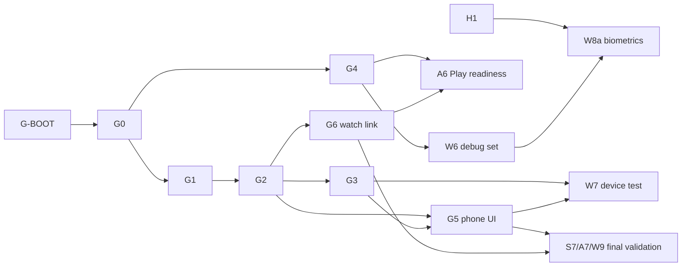

# Execution plans: overview, gates and schedule

Status: **approved**. Source of truth for who does what and in what order. Architecture stays in [`../plan.md`](../plan.md). Lane plans: [shared](shared.md), [android](android.md), [watch](watch.md).

## Context

`docs/plan.md` (merged to `main` in PR #5) fixes the architecture: one Gradle monorepo with `:protocol`
(pure Kotlin/JVM), `:wear` (rename of today's `:app`) and `:phone`, linked over the Wearable Data Layer. It lists
milestones 0-5 but does not say who does what, in what order, or how parallel work is kept safe. Today the repo
holds only the scaffolded `:app` Wear module (`settings.gradle.kts` includes `:app`; CI builds
`./gradlew assembleDebug testDebugUnitTest lintDebug`), so every lane starts from the same skeleton.

This document splits the milestones into **three lanes that run in parallel**, each with its own schedule,
**validation first and last**, and **machine-enforced cross dependencies**: a lane stops at any step whose
required gates are not merged to `main`.

## Working assumptions (confirm on approval)

1. **Lane split** (docs/plan.md does not define "shared and data"):
   - **Shared/data (S)**: repo tooling and restructure, `docs/protocol.md`, `:protocol`, phone data layer
     (`phone/.../data/**`: `WatchLinkDataSource` real + fake, Room, DataStore, repositories), CI guardrails.
   - **Android (A)**: phone app UI/ViewModels (`phone/.../ui/**`), DI wiring, Play readiness.
   - **Watch (W)**: everything in `:wear` (reminders, haptics, ack/selection, link client, tile, debug set, biometrics).
2. **Transport** (open in docs/plan.md): work proceeds on the recommended **DataItems only** option; it is
   recorded in `docs/protocol.md` at gate G1. If the real-watch test (W7) disproves it, a revision gate `G1.1`
   re-opens G1/G2 (see Risks).
3. **Phone scope** beyond the plan's "link-state screen": minimal schedule list/editor and prompt/ack history,
   because the watch needs a schedule source to be testable. Anything more is out of scope here.
4. Threads open one PR per step as the repo's working rules require; **the user merges gate PRs** (that is the
   human checkpoint the stop rule waits on).

## Common rules for all three lanes

## Validation first / last (every lane)

| | First step (V-first) | Last step (V-last) |
|---|---|---|
| Do | Write the **test-case catalogue** `docs/test-plans/<lane>.md` (ids `TC-<S\|A\|W>-nnn`, what / how: unit, CI, manual / pass criteria), generate the test code, run it. | Run the **entire** suite and all CI checks on the merged state; run the manual checklist for the lane. |
| Evidence | `docs/test-reports/<lane>-baseline.md`: each id **red**, with command, output excerpt and commit SHA. The red commit precedes any implementation commit on the branch. | `docs/test-reports/<lane>-final.md`: each id **green**, counts, zero skipped/ignored tests. |
| Checked by | `scripts/check-test-cases.sh <lane> baseline` | `scripts/check-test-cases.sh <lane> final`: every catalogue id appears in a test name and in the final report as PASS; fails on `@Ignore`/`@Disabled`. |

Test names embed the case id so the catalogue, tests and reports stay one source of truth (DRY). Tests that
cannot compile before an upstream gate are split: V-first has a docs-only part (**a**, no dependencies) and a
code part (**b**, needs the contract gate). Red tests live on the thread branch; a step PR is merged only when
its head is green (never disable or skip a test to get green).

## Cross dependencies: gates, documented and enforced

A **gate** is a milestone that exists once its PR is merged to `main`. Gates and their dependencies are data in
**`docs/plans/gates.json`** (`{ id, name, requires[], owner, status: open|merged, pr }`); the PR that completes a
gate flips only its own gate to `merged`, so `main` shows `merged` only after the merge.

| Gate | Meaning (exit criteria) | Owner | Requires |
|---|---|---|---|
| **G-BOOT** | Plan docs, `gates.json`, `scripts/require-gate.sh`, `scripts/check-test-cases.sh`, gate CI job merged | orchestrator (S0) | none |
| **G0** | Skeleton: `:wear` (renamed), `:protocol`, `:phone` build; version catalog; `./gradlew check` runs Spotless/ktlint, detekt, lint, markdownlint + link check; CI updated (`wear/build/...` APK path) | S | G-BOOT |
| **G1** | Contract: `docs/protocol.md` (envelope, message catalog, state machines, error codes, versioning, **transport = DataItems only**) + compile-only `:protocol` declarations (envelope, message types, `LinkState`, `ErrorCode`, `LinkTransport`) + `WatchLinkDataSource` interface | S | G0 |
| **G2** | `:protocol` implemented (codec, handshake, idempotency, LWW sync, retry/backoff, state machines) + `FakeTransport` + `FakeWatchLinkDataSource`; unit tests green | S | G1 |
| **G3** | Phone data layer: Room, DataStore, repositories, real Data Layer `WatchLinkDataSource`; tests green | S | G2, G4 |
| **G4** | Guardrails: same `applicationId` + signing check across `:wear`/`:phone`; "release contains no debug code" check; "mis-formatted change fails" proof | S | G0 |
| **G5** | Phone link-state screen + schedule/history screens merged and green | A | G2, G3 |
| **G6** | Watch link client + reminder engine + ack/selection + connection-state display merged and green | W | G2 |
| **H1** (human) | Biometric metrics and thresholds agreed; decision doc `docs/plans/biometrics.md` merged | user | none |
| **H2** (human) | Galaxy Watch6 Classic + phone available; manual test window confirmed (PR flips the gate) | user | none |

**Stop rule (enforced twice):**

1. **In the thread**: the first action of every step is `scripts/require-gate.sh <gates the step requires>`. It
   runs `git fetch origin main`, reads `origin/main:docs/plans/gates.json`, and exits non-zero (printing each
   blocking gate and its owner) unless every listed gate is `merged`. On non-zero the thread **stops**: it
   commits its work in progress to its branch, appends `BLOCKED: <step> waits for <gate>` to `docs/work-log.md`,
   pushes, and ends its turn. It does not poll or sleep. It resumes when the user (or one scheduled check-in)
   restarts it; the first action is again `require-gate.sh`, then merge `origin/main` into the branch.
2. **In CI**: every step PR body carries `Requires: G0,G1` and `Produces: G2`. A `gates` CI job runs
   `require-gate.sh` for the `Requires` list against the base branch and rejects a PR that flips any gate other
   than its `Produces`. A dependent PR cannot be merged before its dependencies.

`scripts/require-gate.sh` is itself tested first (S0): open gate -> non-zero, merged -> zero, unknown id -> error.

## File ownership (avoids merge conflicts)

| Owner | Paths |
|---|---|
| S | root `build.gradle.kts`, `settings.gradle.kts`, `gradle/**`, `.github/**`, `scripts/**`, `docs/protocol.md`, `protocol/**`, `phone/build.gradle.kts` (until G0), `phone/src/**/data/**` |
| A | `phone/src/**/ui/**`, `phone/src/main/AndroidManifest.xml`, `phone` DI wiring, `docs/phone.md`, final `README.md` |
| W | `wear/src/**`, `wear/build.gradle.kts` (after G0), `docs/watch.md` |
| each | own `docs/test-plans/<lane>.md`, `docs/test-reports/<lane>-*.md`, own section of `docs/work-log.md`; new catalog entries appended in `gradle/libs.versions.toml` under a `# <lane>` comment |

Before G0, W and A do not touch any build file. Branches: `claude/shared-*`, `claude/android-*`,
`claude/watch-*`; each thread merges `origin/main` before every step.

## Schedule (waves; lanes run in parallel, `■` = blocked until gate merged)

| Wave | Shared (S) | Android (A) | Watch (W) |
|---|---|---|---|
| 0 | **S0** bootstrap -> **G-BOOT** (threads launched after merge) | | |
| 1 | S1a, S1b | A1a | W1a, W1b |
| 2 | S2 -> **G0** | ■ waits G0 | ■ waits G0 |
| 3 | S3 -> **G4**, S4 -> **G1** | A1b ■G1, A2 | W1c ■G1 |
| 4 | S5 -> **G2** | A2 finishes | W2 |
| 5 | S6 -> **G3** | A3 ■G2 | W3 ■G2, W4 -> **G6** |
| 6 | | A4, A5 ■G3 -> **G5** | W5, W6 (G4) |
| 7 | | A6 ■G6 | W7 ■G5+H2, W8a ■H1 |
| 8 (last) | S7 V-last | A7 V-last | W9 V-last |

Waves are ordering, not calendar time. Within a wave, steps with no unmet gate start immediately; a thread that
runs out of unblocked work stops per the stop rule.

## Critical files

- Modified by S2: `settings.gradle.kts` (`:app` -> `:wear`, add `:protocol`, `:phone`), `build.gradle.kts`,
  `gradle/libs.versions.toml` (currently only AGP, Kotlin, Compose BOM, Wear Compose, activity-compose, JUnit),
  `.github/workflows/build.yml` (APK path `app/...` -> `wear/...`, call `./gradlew check`), `README.md`
  (single-module wording), `app/` -> `wear/` (keeps `ExampleUnitTest.kt`, `MainActivity.kt`, `MyAdhdPalApp.kt`, `Theme.kt`).
- New: `docs/plans/{shared,android,watch}.md` and `gates.json`, `scripts/{require-gate,check-test-cases}.sh`,
  `scripts/verify/**`, `docs/test-plans/**`, `docs/test-reports/**`, `docs/protocol.md`, `protocol/**`, `phone/**`.
- Reuse: existing version catalog and `wear` build config as the template for `phone/build.gradle.kts`
  (JDK 21, `compileSdk 37`, `minSdk 30` for wear; phone minSdk to be chosen in S1b).

## Verification (of the plans themselves, at S0)

- `scripts/require-gate.sh G1` exits non-zero on the bootstrap `main`; `scripts/require-gate.sh G-BOOT` exits zero.
- `scripts/check-test-cases.sh` fails on a catalogue id with no test and on an `@Ignore`d test.
- CI `gates` job fails a deliberately premature PR (`Requires: G2`), then passes once G2 is `merged`.
- Dry run: launch the Watch thread before G0 and confirm it stops, logs `BLOCKED`, and pushes without touching build files.

## Risks

- **Transport assumption disproved** by W7: open `G1.1`; S revises protocol.md and `:protocol`; A and W merge `main` and re-run baselines.
- **Tool compatibility** with AGP 9.4/Kotlin 2.4 (Hilt, KSP, Room, Spotless, detekt): S1b decides before S2 pins versions; fall back to manual DI.
- **Health Services behaviour** unverified: W1b research and H1 gate before any biometric code.
- **Human gates (H1, H2, gate PR merges)** can idle a lane; the stop rule makes that visible in `docs/work-log.md`.
- **Red-first on a shared `main`**: red evidence is a branch artifact; `main` only ever receives green heads.
