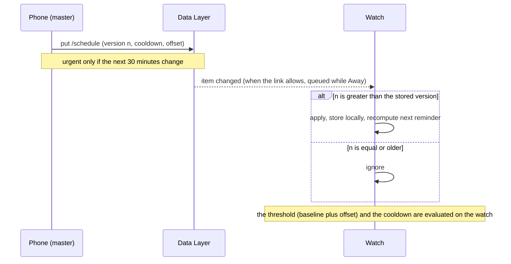
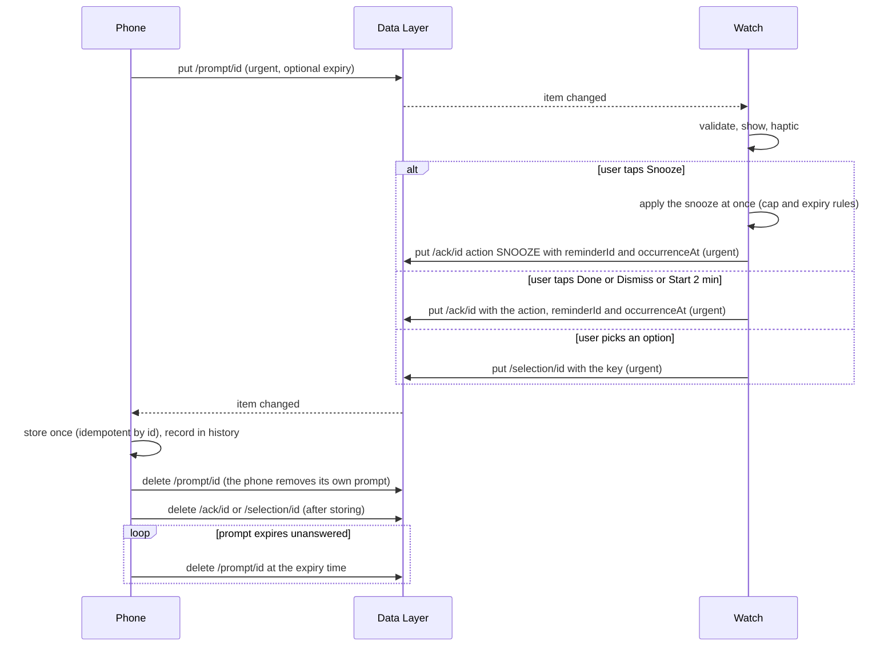
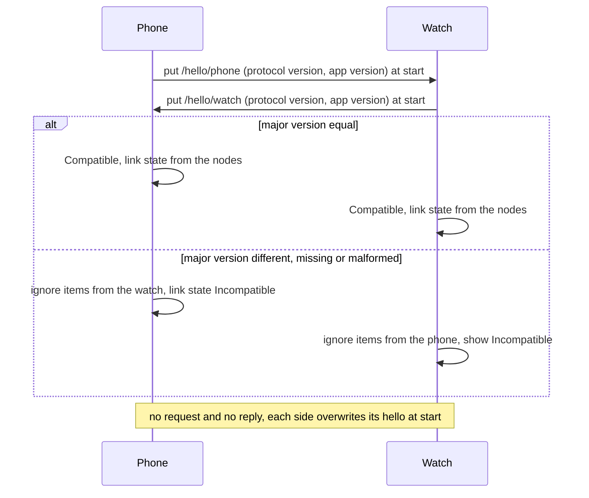
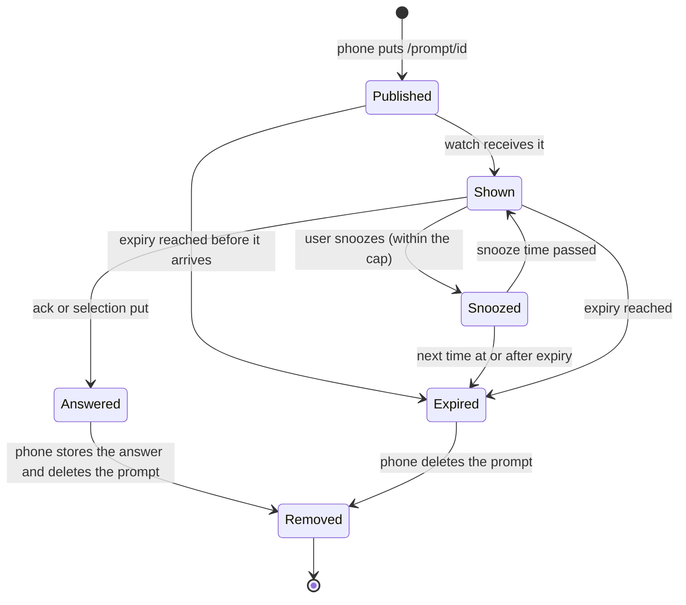
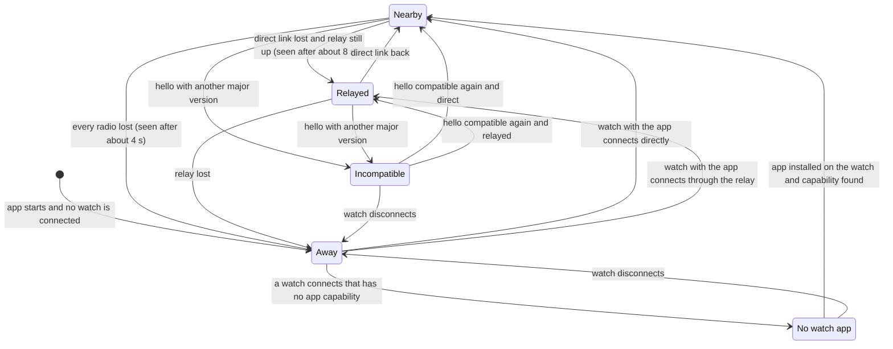
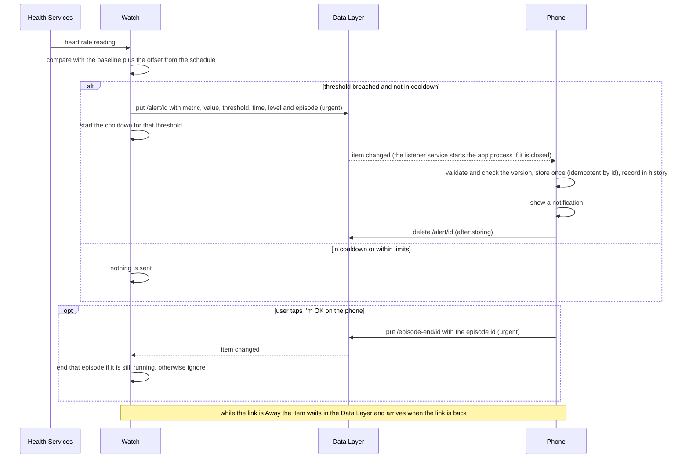

# Watch-phone protocol

Status: **skeleton** (protocol 1.3; steps 1.1 to 1.8 are done). This file is the single source of
truth; the constants, models, codec, compatibility rule, schedule logic and transport abstraction in `:protocol` follow
it, and unit tests keep them equal. The link-state function and the link-state and alert diagrams (steps 1.5 and 1.8b)
complete gate G2b. The transport verification below comes first in time and changes the cleanup rule.

## Item catalog

All traffic is Data Layer items (decision in [`plan.md`](plan.md) section 3). The writer is the only node that creates,
replaces or deletes an item (writer-owns-cleanup rule, see below).

| Path | Direction | Body model | Urgent | Cleanup |
|---|---|---|---|---|
| `/schedule` | phone to watch | `Schedule` | only if it changes the next 30 minutes | replaced by the next version |
| `/prompt/<id>` | phone to watch | `Prompt` | yes | phone deletes it on the answer or at expiry |
| `/ack/<id>` | watch to phone | `Acknowledgement` | yes | watch deletes it after a delay, or the phone after storing it |
| `/selection/<id>` | watch to phone | `Selection` | yes | same as `/ack/<id>` |
| `/alert/<id>` | watch to phone | `Alert` | yes | same as `/ack/<id>` |
| `/episode-end/<id>` | phone to watch | `EpisodeEnd` | yes | phone deletes its own old ones (older than one hour) when it starts and when it writes a new one; the watch never deletes it |
| `/status/watch` | watch to phone | `WatchStatus` | no | overwritten |
| `/hello/phone` | phone to watch | `Hello` | no | overwritten at start |
| `/hello/watch` | watch to phone | `Hello` | no | overwritten at start |
| `/debug/biometrics` | watch to phone | `BiometricSamples` | no | debug builds only; overwritten |

`<id>` is a lower-case canonical UUID (`123e4567-e89b-42d3-a456-426614174000`). A path with any other id, a trailing
slash or an extra segment is not a protocol path and is ignored.

## Item format

Every item has four keys:

| Key | Type | Meaning |
|---|---|---|
| `v` | int | protocol major version of the writer |
| `id` | string | UUID of the item; the same as `<id>` in the path for event items; a fresh UUID per write for the others |
| `ts` | long | sender clock in epoch milliseconds when the item was written |
| `body` | string | JSON produced by the `:protocol` codec |

`:protocol` never touches Android's `DataMap`; thin adapters in `:wear` and `:phone` convert between `DataMap` and the
`Envelope` type. Times inside a body (`at`, `expiresAt`) are epoch milliseconds on the clock of the node that wrote the
item. The two clocks differ (the emulator spike measured about 1.5 s), so a receiver never computes a delay from them.

**Prompt expiry.** `Prompt.expiresAt` is an absolute epoch-millisecond time on the phone's clock. The phone stays the
authority and deletes an expired prompt when it can (writer-owns-cleanup rule). The watch additionally hides and ignores a
prompt once its own clock is at or past `expiresAt`, and never shows an already-expired prompt that it receives late. This
is not a delay measurement: expiry is on a scale of minutes, and the clocks of real, NTP-synced devices differ by far less
than the 1.5 s seen between the emulators, so a prompt may be shown or hidden a few seconds early or late.

Bodies (field names are the JSON keys):

| Model | Fields |
|---|---|
| `Schedule` | `version` (long, monotonic), `reminders` (`id`, `title`, `minuteOfDay` 0-1439, `days` 1-7 with 1 = Monday), `checkpoints` (`id`, `label`, `minuteOfDay`), `snooze` (`minutes`, `maxCount`), `alerts` (`cooldownSeconds`; `offsetBpm` 20-50, default 30, and `initialBpm` 30-220, default 110, protocol 1.2) |
| `Prompt` | `title`, `options` (1 to 6 of `key`, `label`; keys unique), `expiresAt` (optional) |
| `Acknowledgement` | `action` (`DONE`, `SNOOZE`, `START_2_MIN`, `DISMISS`), `at`, optional `reminderId` (the `Reminder.id` it answers, 1 to 32 characters), optional `occurrenceAt` (epoch milliseconds on the watch clock of the scheduled fire time it answers, not negative; protocol 1.1) |
| `Selection` | `key` (an option key of the prompt with the same id), `at` |
| `Alert` | `metric` (`HEART_RATE`), `value`, `threshold`, `at`, `level` (1 or 2, default 1; protocol 1.2), optional `episodeId` (canonical UUID shared by all alerts of one episode; protocol 1.2) |
| `EpisodeEnd` | `episodeId` (the `episodeId` of the alert the user answered "I'm OK" to), `at` (epoch milliseconds on the phone clock, not negative); protocol 1.2 |
| `WatchStatus` | optional `baselineBpm` and `thresholdBpm` (30 to 250), `heartRatePermission` (`GRANTED`, `DENIED`, `UNKNOWN`); protocol 1.2 |
| `Hello` | `side` (`PHONE`, `WATCH`), `protocolVersion` (for example `1.0`), `appVersion` |
| `BiometricSamples` | `samples` (`at`, `heartRate`), at most 500 |

Limits (`Limits` in `:protocol`): 100 reminders, 24 checkpoints, 6 options, texts 1 to 200 characters,
keys and versions 1 to 32 characters, snooze 1 to 240 minutes and 0 to 10 snoozes, cooldown 0 to 86400 seconds. The
largest legal item stays below 40 KB, less than half of the 100 KB DataItem limit.

An item whose body is malformed, has a missing or mistyped required field, an unknown enum value or an out-of-limit
value is dropped, and the failure is logged in debug builds. Unknown extra fields are ignored and the known fields are
kept.

## Versioning policy

`Protocol.VERSION` is `major.minor`. The major version is the compatibility boundary and is written in `v` of every
item and in the `Hello` body. Additive changes (a new optional field, a new item path) raise the minor version and stay
compatible; a receiver ignores fields and paths it does not know. A change that removes or reinterprets a field raises
the major version. A receiver ignores items whose major version it does not support and shows Incompatible. There is no
negotiation, request or reply.

Version history: **1.0** is the first version. **1.1** adds the optional `reminderId` and `occurrenceAt` to
`Acknowledgement`, so the phone can tell which reminder (and which occurrence of it) an acknowledgement answers; the
path id of `/ack/<id>` stays a fresh UUID per acknowledgement. Absent optional fields are not written, so a 1.0 body
without them still decodes and a 1.1 body is read by a 1.0 receiver, which ignores the extra fields. This is a minor
bump: paths, keys and the other models are unchanged.

**1.2** (issue 168, the biometric alerts of [`plans/biometrics.md`](plans/biometrics.md)) adds `Alert.level` and
`Alert.episodeId`, `AlertSettings.offsetBpm` and `initialBpm` (the threshold is the resting baseline plus the offset,
`initialBpm` until a baseline exists), the phone-to-watch item `/episode-end/<id>` (`EpisodeEnd`) and the watch-to-phone
item `/status/watch` (`WatchStatus`). All new fields have defaults or are optional, so 1.1 bodies decode and a 1.1
receiver ignores the new fields and the two new paths. Minor bump again; the constants of the alerts live in
`AlertRules` (cooldown 300 s, escalation repeat 120 s, at most 6 level-2 repeats per episode).

**1.3** (issue 55 decision) removes the absolute thresholds: `AlertSettings.thresholds`, `Threshold`, `Direction` and
`Limits.MAX_THRESHOLDS` are gone, because the only rule is the resting baseline plus the offset. A body that still has a
`thresholds` list (1.2 and older) decodes and the list is ignored. The change is not backward compatible in one
direction: a 1.2 watch requires `thresholds` and drops a schedule written without it, so the phone and the watch app
must be updated together (one repository, one installation of each; the user has one watch). The major version stays 1.

**"I'm OK" on the phone** ends the episode on the watch: the phone writes `/episode-end/<id>` with the `episodeId` of the
alert answered. The watch ends that episode and ignores the item when the episode is unknown or already over, so a late
item cannot end a newer episode. The watch owns the count of level-2 repeats; the phone only reacts to what arrives.

The rule is `Compatibility` in `:protocol`. `Compatibility.ofMajor(v)` is Compatible only when `v` equals
`Protocol.MAJOR_VERSION`. `Compatibility.ofHello(text)` parses the hello's `protocolVersion` (`major.minor`, optionally
`.patch`, each part 1 to 4 digits; anything else, a missing value and a very long number included, is malformed) and
applies the same rule; a missing or malformed version is Incompatible and never throws. `Codec.decodeIfCompatible`
returns a failure, so the item is ignored, when the envelope's major version is not supported; minor and patch
differences are accepted.

## Schedule logic

Pure functions in `:protocol` (`ScheduleLogic`), given the current instant and a time zone, so tests use a fixed clock.

- **Next reminder / next checkpoint:** the first occurrence strictly after now. Reminder times are wall-clock times in the
  device's time zone on the selected days (1 = Monday to 7 = Sunday); checkpoints repeat every day. With no reminders
  (or checkpoints) there is none. Ties go to the earlier list entry. A checkpoint after the last one of the day is the
  first one after midnight.
- **Daylight-saving change:** a time in the skipped hour of a spring-forward day fires at the first valid time after the
  gap (02:30 becomes 03:30); a time in the repeated hour of a fall-back day fires once, at its first occurrence. A
  time-zone change recomputes the next occurrence on the new wall clock.
- **Snooze:** moves the reminder to now plus `snooze.minutes`, counting snoozes used for this occurrence. It is denied at
  the cap (`snoozeCount` has reached `snooze.maxCount`; 0 turns snoozing off) and, when the occurrence expires, if the
  new time would be at or after the expiry. The cap is reported first.
- **Newer version:** a schedule applies only if its `version` is greater than the one in use (or none is in use); equal and
  older versions are ignored.

## Transport abstraction

`:protocol` defines `LinkTransport`, the one interface the apps use to reach the other node: `put(path, envelope)`,
`delete(path)`, `items()`, `setListener(...)` and the read-only `linkState` (one of the five states below). The real
implementations wrap the Wearable Data Layer in `:wear` and `:phone` and compute `linkState` with the link-state function;
tests use `FakeLink` (two `FakeNode`s), which behaves like DataItems:

- a write is stored on the writer at once, and delivered to the other node when the link is Nearby, Relayed or
  Incompatible; while the link is Away or there is No watch app it is queued and delivered in order on reconnect;
- a newer item at the same path replaces the older one, also in the queue (the other node sees only the newest);
- a deletion reaches the other node the same way; an item deleted before it was delivered is never delivered, and a
  deleted item is not redelivered after a reconnect;
- repeated disconnects and reconnects give no duplicates and no loss; state changes call `onLinkStateChanged` on both nodes.

If the hardware spike requires `MessageClient` for urgent alerts, it is added behind this interface; no path, key or model
changes.

### Urgent alerts and the queue

What the sections above and [`data-layer.md`](data-layer.md) already say, stated for `/alert/<id>`:

- `/alert/<id>` is an urgent item (item catalog). The writer stores it at once and the other node receives it when the link is Nearby, Relayed or Incompatible.
- Queueing and delivery in order on reconnect applies only while the link is Away or there is No watch app. That is the exception path, not the normal one.

The user's words (2026-10-17), verbatim:

> It is expected that when the app is executed it stays on, it continuously measures pulse and other biometrics (to be discussed) and transmits / receives urgent events immediately.
>
> The "batch" [...] is reserved to exceptions: disconnects, phone down, watch down, pairing down, network down, etc.

## Link states

The phone shows one of five states for the watch link. `LinkStateLogic.derive` in `:protocol` (step 1.5) derives it from
three observations, which the data sources in `:phone` and `:wear` read from the Data Layer: the connected nodes
(`NodeClient.getConnectedNodes()`, each with `isNearby`), the reachable nodes that declare the peer's capability
(`adhd_pal_watch` for the phone, `adhd_pal_phone` for the watch; `CapabilityClient`), and the `protocolVersion` of the
peer's hello item. The watch calls the same function and shows No watch app (there: no phone app) as Away.

| State | Meaning |
|---|---|
| Nearby | the watch app is installed, the watch is directly connected, and its hello version is compatible |
| Relayed | the watch app is installed, the watch is connected only through the relay, and its hello version is compatible |
| Away | no watch is connected |
| No watch app | a watch is paired, but without the app capability |
| Incompatible | the watch's hello has an unsupported major version, or is missing or malformed |

Precedence, first match wins:

| Step | Condition | State |
|---|---|---|
| 1 | no connected node and no node with the app | Away |
| 2 | no node with the app | No watch app |
| 3 | the hello version is present and its major is not the supported one, or it is malformed | Incompatible |
| 4 | a node with the app is nearby | Nearby |
| 5 | otherwise | Relayed |

Rules behind the table:

- A watch that is connected but has no app capability is No watch app, whatever its hello says. A watch that is not
  connected is Away, because the Data Layer reports no paired-but-disconnected node and the app capability of such a
  watch is unknown.
- A node with the app that the node list does not (yet) show still counts as a reachable watch: the two Data Layer
  queries are not atomic, so the capability list decides on its own.
- No hello item yet (`null`) does not make the link Incompatible. The capability already proves the app is installed,
  and the watch app writes its hello at start; the version check applies as soon as the hello arrives. An item that
  cannot be decoded is passed on as malformed text and is Incompatible.
- With several watches the nearest one with the app decides (any nearby node gives Nearby).
- Hardware: Nearby, Relayed and Away were seen on the Galaxy A55 5G with the Galaxy Watch6 Classic (spike 0b.2b, below).
  No watch app and Incompatible are covered by unit tests only. The app must refresh the node list about every 2 s while
  it shows the state, since the Data Layer offers no documented callback for it.

## Diagrams

The flows below are the same under the DataItems-only transport and under a `MessageClient` fallback for urgent alerts,
because both are written against `LinkTransport`.

### Schedule sync

### Prompt, acknowledgement and selection

### Hello and version check

### Prompt state machine

### Link state machine

The state is not stored: `LinkStateLogic.derive` recomputes it from the observations (see Link states), and the
transitions below are the events that change an observation. The state names are the members of `LinkState`, and
a test keeps the two equal. Times are those seen on the hardware (spike 0b.2b).

### Alert flow

## Transport verification: spike 0b.2a (paired emulators)

Why the validation was built this way, how it went, where its pieces live, what could have been faster and the exact
specification of the spike apps and tests: [`spikes/README.md`](spikes/README.md).

Question set from [`plan.md`](plan.md) section 3: (1) items persist while the receiver is away and arrive on reconnect,
(2) the phone's listener service wakes with its app closed, (3) a consumed item can be deleted and does not reappear,
(4) urgent-item delay. The spike apps are kept in the debug builds
(`phone/src/debug/` and `wear/src/debug/`, package `...debug.spike`) and the runner is `scripts/spike/run-0b2a.ps1`;
release builds do not contain them. Run by the user on real Android emulators, not on hardware.

### Environment

| | |
|---|---|
| Host | Windows 11, PowerShell, Android Studio (version not reported) |
| Phone emulator | image `sdk_gphone16k_x86_64`, API 36, Google Play |
| Watch emulator | AVD `Wear_OS_Large_Round` (API level not reported) |
| Pairing | Device Manager, Pair Wearable |
| Spike build | apps from commit `5abd291` in the manual runs; runner `7476512` for the first scripted run |
| Google sign-in | not completed on either emulator, and items still crossed: **no Google sign-in is needed on emulators** |

Clock skew between the two emulators: **about -1.5 s (watch behind phone)**, measured as -1496 ms by the runner (about
1.55 s in the manual run). Every `delayMs` value in the spike compares two different clocks, so it contains this skew
and is **not** a delivery delay.

### Results

| Case | Question | Result | Evidence |
|---|---|---|---|
| C1 items cross the pairing, both ways (TC-S-121) | 3 | PASS | `RECV` on the receiver in both directions, in the manual runs and in the scripted run |
| C1b deletion symmetry (TC-S-124) | 3 | **FAIL in one direction**, see below | skew -1496 ms; table below |
| C2a a KEEP item stays on both devices | 3 | PASS | listed on phone and watch |
| C3a phone listener wakes with the app closed, background process killed, `pidof` empty (TC-S-123) | 2 | PASS | `SERVICE-CREATED`, `RECV` with `fg=false` in a fresh process, `processUptimeMs=510` |
| C3b the same after `am force-stop` | 2 | PASS | `fg=false`, `processUptimeMs=447` |
| C5 watch away: sent while the watch emulator was off, then it restarted (TC-S-122, TC-S-125) | 1 | PASS | items arrived 12 s after boot completed, the sender saw `NODES count=0` while away, and the link recovered on its own with nothing done by the user |
| C5 phone away | 1, 2 | not run | deferred to 0b.2b |
| C2b deleted items do not reappear after the reconnect | 3 | not run | deferred to 0b.2b |
| C4 urgent versus non-urgent delay | 4 | not run | deferred to 0b.2b |

Delivery after a cold start was about 2 to 3 s once the clock skew is removed (manual run, indicative only).

### Deletion finding

The scripted case C1b wrote three items per group, deleted them on the receiving side, waited 45 s, then listed the
items on both devices. "Writer" is the node that wrote the item, "deleter" the other node.

| Group | Items | Still listed on the writer | Still listed on the deleter | Writer logged the deletion event |
|---|---|---|---|---|
| watch writes, phone deletes at once | 3 | 0 | 0 | 3 of 3 |
| watch writes, phone deletes after 6 s | 3 | 0 | 0 | 3 of 3 |
| phone writes, watch deletes at once | 3 | **3** | 0 | **0 of 3** |
| phone writes, watch deletes after 6 s | 3 | 0 | 0 | 3 of 3 |

Only a delete by the watch of a phone-written item, issued straight after the item arrived, was lost on the phone:
the watch reported success (`count=1`), yet the phone still listed the item and never received a deletion event. In the
manual run such an item was still listed on the phone 27 minutes later. Every other group is clean. The spike code is
symmetric (the same `deleteDataItems` call on the item's own URI on both sides), so a spike bug is not the explanation.

**Hypothesis, not proven:** Data Layer writes and deletes are time-stamped, and the watch clock is about 1.5 s behind the
phone. A delete made within the skew window after the phone's write is then stamped as older than the write and does
not win, while the phone's delete of a watch-written item is always stamped later, and a delete 6 s later (more than the
skew) also wins. The pattern fits, but only the real devices (0b.2b, with their own clock offset) can confirm it.

### Rule that follows: the writer owns cleanup

Replaces "the consumer deletes an item after storing it" in [`plan.md`](plan.md) section 4:

- A node deletes the items it wrote itself. The **watch never deletes phone-written items** (`/prompt/<id>`,
  `/schedule`): the phone removes a prompt when it receives the answer or when the prompt expires.
- The **phone may delete watch-written events** (`/ack/<id>`, `/selection/<id>`, `/alert/<id>`) after storing them,
  because that direction worked in every run.
- Consumers stay idempotent by `id`: an item that survives a lost delete is handled once, so a surviving item is harmless.

This was decided from emulator evidence. The hardware spike (below) repeated the deletion groups and found no asymmetry
on the real devices; the rule stays, because it costs nothing and does not depend on the clock offset.

### Other observations

- The Google Pixel Watch companion app on the phone emulator stopped once ("keeps stopping") on an earlier attempt. The
  effect on the link was not determined. Because the emulator pairing is bridged by that app, it matters for the
  reconnect cases, and 0b.2b checks the Samsung pairing path separately.
- Two spike-tooling problems cost time and are not protocol findings: the first scripted run hung at C5 because an
  `adb` call to the stopped emulator never returned (fixed in the runner with per-call timeouts), and the host laptop
  went to sleep during a run.
- The partial output of the first scripted run is kept as evidence:
  [`spikes/results/0b2a-first-real-run-partial.txt`](spikes/results/0b2a-first-real-run-partial.txt).

### Fallback-rule evaluation

Rule from [`plan.md`](plan.md) section 3: if the spike fails on (2) the listener wake-up or (3) deletion, or urgent
alerts are too slow, add `MessageClient` for urgent alerts only; everything else stays as items.

| Criterion | Emulator outcome | Consequence |
|---|---|---|
| (2) listener wakes with the app closed | PASS, both after a kill and after a force-stop | none |
| (3) a consumed item can be deleted and does not reappear | works, except a quick delete by the watch of a phone-written item | not a trigger: the writer-owns-cleanup rule avoids the failing case without changing the transport |
| (4) urgent-item delay | not measured; every `delayMs` is clock-skew contaminated | decided in 0b.2b with round trips on one clock and delay targets agreed first |
| (1) persistence while away | PASS with the watch away; phone away not run | phone away is checked in 0b.2b |

**Decision at G-SPK1:** the transport stays **DataItems only**; the `MessageClient` fallback is not applied. The hardware
spike below confirmed it.

### Deferred to the hardware spike (0b.2b, done below)

The laptop sleeping and the hung first runner stopped the emulator runs; these are not protocol failures. Move into the
0b.2b checklist, and reuse the same runner (`scripts/spike/run-0b2a.ps1`, with
`-OnlyCases`, which also reports round trips on the sender's own clock):

- C5 phone away (the listener started by a restarted phone), C2b (deleted items do not reappear), C4 urgent versus
  non-urgent round trips, and a repeat of the C1b deletion groups.
- The hardware-only items already in the plan: Nearby, Relayed and Away, Samsung battery management with default
  settings, and pairing through the Galaxy Wearable app. The runner's emulator restart and `adb emu kill` steps do not
  apply to a watch and phone; how the away state is produced on hardware is decided in 0b.2b.

## Transport verification: spike 0b.2b (Galaxy Watch6 Classic and Galaxy A55 5G)

The same four questions on the real devices, run by the user with `scripts/spike/run-0b2b.ps1` from `main`
(debug builds; plan: [`spikes/0b2b-plan.md`](spikes/0b2b-plan.md)). The phone was on USB, the
watch on Wi-Fi debugging, and the runner switched the phone's radios with `adb`. The raw outputs are kept in
[`spikes/results/`](spikes/results/) (`0b2b-*/results.txt`) and the per-case logs next to them (also the first, partial 0b.2a run).

### Environment (hardware)

| | Phone | Watch |
|---|---|---|
| Model | Samsung SM-A556E (Galaxy A55 5G) | Samsung SM-R965F (Galaxy Watch6 Classic) |
| Android | 16 (API 36) | 16 (API 36, Wear OS 6) |
| One UI | 8.5 (80500) | One UI Watch 8 (80000) |
| Build | BP4A.251205.006.A556EXXSIDZI3 | BP2A.250325.020.R965FXXS2CZF5 |
| Google Play services | 26.39.33 | 26.39.33 |
| Galaxy Wearable | 2.2.72.26092361 | not reported |
| Battery settings | defaults for the run; standby bucket 50 (first run) and 10 (later runs), not in the Doze allow-list | on Wi-Fi, advised on its charger |

Host: Windows 11 (NT 10.0.26220), PowerShell 7.6.6. Runner commit `bc1b4e5` for the first runs; `d689afa` for the last
two (it fixes a bug of the runner, not of the protocol: the C3d blocks could not call `Invoke-Adb`, so C3d was rerun).
Clock skew between the devices: -76, -90, -135, -236, -532 and -1054 ms in the six runs (watch behind the phone), so the
offset is **not constant** and a delay must never be computed from the two clocks.

### Results on hardware (targets: nearby 10 s, relayed 60 s, away 180 s, app closed 120 s)

| Case | Question | Result | Evidence |
|---|---|---|---|
| C1 items cross both ways | 3 | PASS | `RECV` both ways |
| C1b deletion in both directions, immediate and after 6 s, three items each | 3 | PASS | 0 items left on the writer or the deleter in all four groups, the writer saw all 12 deletion events, **including the immediate phone-written item deleted by the watch that failed on the emulators** |
| C2a a KEEP item stays | 3 | PASS | listed on both devices |
| C2b after the Away reconnect, deleted items did not reappear and the KEEP item is still there | 3 | PASS | listed on both devices |
| C3a phone app killed | 2 | PASS | `RECV` with `fg=false`, `processUptimeMs=221` |
| C3b phone app force-stopped | 2 | PASS | `fg=false`, `processUptimeMs=244` |
| C3c screen off and Doze forced (`dumpsys deviceidle force-idle`), app closed | 2 | PASS | urgent and non-urgent item received in 1 s |
| C3d app in the `rare` standby bucket | 2 | PASS | urgent 4 s, non-urgent 3 s |
| C3d app in the `restricted` standby bucket | 2 | PASS | urgent 3 s, non-urgent 3 s |
| L1 Nearby: round trips on the sender's own clock, 3 urgent and 3 non-urgent from each side | 4 | PASS | urgent median 201 ms (watch-started) and 223 ms (phone-started); non-urgent 192 and 230 ms |
| L2 Relayed: phone Bluetooth off, both online | 4 | PASS | the watch listed the phone as connected and not nearby **8 s** after Bluetooth went off; urgent median 1721 ms and 1815 ms; non-urgent 1830 and 1747 ms |
| L3 Away: phone Bluetooth, Wi-Fi and mobile data off, both sides send, radios restored | 1, 2 | PASS | the watch saw no phone **4 s** after the radios went off; all four items (a DEL and a KEEP item each way) arrived 2 to 16 s after the radios came back, with no action by the user; the phone listener ran with the app closed (`fg=false`); the watch saw the phone as nearby again 2 s after the restore |

Urgent and non-urgent items took the same time within the noise on every link state, so `setUrgent()` made no measurable
difference on these devices; it stays on for the items listed in the item catalog because it costs nothing.

### What the results mean for the design

- **Link state (step 1.5).** The three observations the function needs exist on the hardware: the node list with
  `isNearby` true (Nearby), a connected node with `isNearby` false (Relayed, seen 8 s after the Bluetooth link dropped),
  and an empty node list (Away, seen 4 s after the phone lost every radio). The runner asked for the list every 2 s, so
  the app must refresh it at a similar rate while it shows the state, since there is no documented callback. No watch app
  (a paired node without the capability) and Incompatible (from the hello) were not exercised on hardware.
- **Deletion.** The asymmetry found on the emulators did not occur. The writer-owns-cleanup rule stays as the safe rule.
- **Delivery with the phone app closed** works after a kill, a force-stop, Doze and the `rare` and `restricted` standby
  buckets, within 1 to 4 s.

### Checklist answers from the user

| # | Item | Answer |
|---|---|---|
| 1 | Pairing | The phone and watch were already paired over Bluetooth before the test (an existing pairing, not created for it). The app used to pair was not stated; Galaxy Wearable 2.2.72.26092361 is installed on the phone. |
| 2 | Phone battery management | All at default, nothing changed by the user. Settings > Battery > Background usage limits: **Put unused apps to sleep is ON**; "Auto disable unused apps" and "Adaptive battery" do not exist on this One UI 8.5 screen. |
| 3 | The spike app | Listed as "ADHD Pal" (the Spike is an extra launcher icon of the same app). Its Battery setting is **Optimized**. Whether it is in "Never sleeping apps" was not stated; it is treated as **not exempt**, which the runner's Doze allow-list check (False) agrees with. |
| 4 | State after the last run | Phone Bluetooth, Wi-Fi and mobile data on, both devices on the same Wi-Fi, watch connected. |

Because "Put unused apps to sleep" is on and the app is not exempt, the days-long sleeping-apps check stays worth doing.

### Not verified on hardware

- **Samsung's own "sleeping apps" and "deep sleeping apps" lists.** They act on apps unused for days and cannot be forced
  by `adb`; the recheck after three idle days (checklist item 9 of the plan: do not open the app for three days, then run
  `run-0b2b.ps1 -SkipBuild -OnlyCases C3`) is **open**, and worth doing because "Put unused apps to sleep" is on and the app
  is not exempt. Until then the risk row in `plan.md` section 8 stays open for the phone's background listener.
- **Watch away.** The watch's own radios could not be switched off while `adb` ran over its Wi-Fi, so only phone-side
  isolation was tested; the watch-away direction passed on the emulators (0b.2a).
- Only one phone and one watch were tested, on one firmware each.

### Fallback-rule evaluation (final)

| Criterion | Hardware outcome | Consequence |
|---|---|---|
| (1) persistence while away | PASS with the phone away and sending from both sides | none |
| (2) listener wakes with the app closed | PASS after kill, force-stop, Doze and standby buckets | none |
| (3) a consumed item can be deleted and does not reappear | PASS in both directions | none |
| (4) urgent-item delay | nearby about 0.2 s, relayed about 1.8 s round trip, away items within 16 s of the link coming back | all far inside the targets |

### Transport decision (step 0b.3)

**The transport is DataItems only.** No criterion of the fallback rule was missed, so `MessageClient` for urgent alerts is
**not** added. Section 3 of [`plan.md`](plan.md) is updated to say so. The spike apps and runners stay in the repository as
test tooling (debug builds only, `scripts/spike/`), so the evidence above can be reproduced. No path, key or model of the protocol changes; the next steps are 1.5 and 1.8b (gate G2b).
